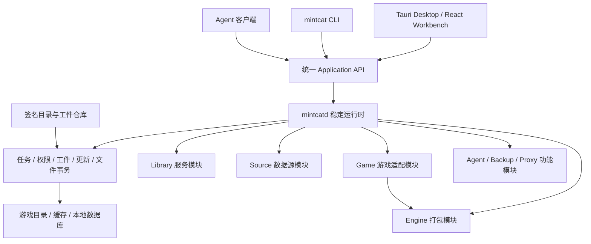

# Mintcat 模块化运行时与大规模重构设计

状态：目标架构与重构前的历史调研基线，不是全部目标能力已验收的声明。当前代码入口为 `apps/desktop`、`apps/cli` 与 `runtime/daemon`；第 1 节的 renderer SQL、Agent CLI bridge、FFI/旧更新路径已经退役，保留为迁移决策证据。当前实现与未完成验收以 [执行记录](modular-refactor-todo.md) 为准。

后续实现入口：[可执行重构 TODO](modular-refactor-todo.md)，包含 R00–R35 的依赖、文件范围、动作与验收；下载数据并发的完整协议见 [专项设计](mod-download-concurrency.md)。两份补充文档与本文共同构成实施要求。

## 0. 核心决策

推荐架构：**稳定的原生内核 + 无界面的本地运行时 + 可独立发布的业务模块 + 插槽式桌面工作台 + 统一应用协议 + 原子切换的兼容版本集合**。

具体决定：

1. 保留 Tauri、React、Rust 和已有游戏算法，不换技术栈重写全部代码。
2. 把业务执行权从 React/ViewModel 移到本地运行时；GUI、CLI、内置 Agent 都是客户端。
3. 以业务边界拆模块，不以“每个类、每个函数、每个文件”拆插件。源码拆分、发布包、进程实例是三种不同粒度。
4. 一个功能包可以同时提供 UI、后端服务、命令、设置和资源；纯 UI、纯后端、纯资源包同样合法。
5. 可更新的原生业务代码运行在受管理的独立进程中，不继续以宿主进程内 DLL 作为主扩展机制。
6. 所有安装、打包、下载都是后端持有的任务；关闭窗口、CLI 断连、前端更新不改变任务的所有权。
7. 模块独立版本化；服务端按更新域发布经过验证的精确依赖组合，客户端不能各自追逐每个依赖的 latest，也不要求所有游戏一起升级。
8. 游戏安装和软件更新是两套事务：前者保护游戏文件，后者保护运行时版本，不能混用一个“安装成功”状态。
9. 热更新意味着“无需重新安装整应用即可安全采用新模块”，**不意味着任意时刻替换正在运行的栈、已加载进游戏的 DLL 或不兼容数据库**。
10. 默认仅加载可信发布者的签名模块。独立进程隔离崩溃，不自动构成恶意原生代码的操作系统沙箱。
11. **每个游戏安装插件独立发布、检查更新、激活、灰度、暂停和回滚**。DRG 更新不要求更新 Rogue Core、重发 GUI 或重发 CLI。
12. 下载并更新配置必须取得后端原子能力锁；任务固定输入、条件提交，不能让迟到回调覆盖用户新的列表。详细协议见 [下载并发与原子能力锁](mod-download-concurrency.md)。

最终用户应看到：安装新的游戏支持或更新某个功能，不需要重发整个客户端；开发者应看到：同一个用例只实现一次，UI 和 CLI 调用同一契约。

## 1. 重构前基线：已有基础与实际缺口（历史证据）

### 1.1 当前调用链

```text
React 页面 / Agent 面板 / CLI 的前端桥
    -> TypeScript Service / ViewModel
    -> 前端 SQLite DAO / 前端任务编排
    -> backend_invoke
    -> Tauri 宿主按字符串命令分发
    -> libloading 加载一个 Backend Runtime
    -> C ABI + JSON
    -> 单个 FFI crate 中的命令 match
    -> DRG / Rogue Core 安装器、Proxy 管理、Nexus WebView 策略
```

当前的 `tauri-plugin-*` 主要是编译期宿主功能，不等于可以从服务端下载、动态注册、独立升级的业务插件。

### 1.2 关键证据

以下记录重构前工作区的代码事实，路径和执行链不代表当前实现；由事实推导的后果标注 `[INFERENCE]`，不冒充运行复现。

| 现状 | 证据 | 对重构的约束 |
| --- | --- | --- |
| 页面、菜单和 Agent 面板由主应用直接 import 和注册 | `src/App.tsx:14-20,179-185`；`src/components/MenuBar.tsx:10-35` | 主界面不是只消费扩展声明的框架 |
| Service/ViewModel 由固定 IoC 清单装配 | `src/core/IoCRegistration.ts:32-104` | 增加功能仍需改主应用装配代码 |
| 数据库经前端 Tauri SQL 插件打开 | `src/storage/db/Client.ts:27-75` | CLI 无法独立复用当前业务执行路径 |
| 安装任务依赖 ProfileViewModel、React 弹窗、前端文件 API | `src/tasks/ModInstallTask.ts:1-18,113-163` | UI 生命周期与业务生命周期耦合 |
| 安装先卸载旧内容，再开始集成 | `src/tasks/ModInstallTask.ts:356-394` | `[INFERENCE]` 后续失败可能使用户失去原可用安装 |
| 安装完成靠全局事件；调用后才订阅完成事件 | `src/apis/IntegrateApi.ts:75-114`；`src/events/EventRegistry.ts:212-216` | `[INFERENCE]` 快速完成、并发任务和断连恢复缺少可靠关联依据 |
| 游戏差异散布在 Steam ID、搜索来源、资源选择、默认数据中 | `IntegrateApi.ts:11-15,137-148`；`ModSearchService.ts:23-50`；`ModInstallTask.ts:313-323`；`DatabaseInitializer.ts:103-112` | 增加游戏不是增加一个游戏模块即可完成 |
| 宿主安装 DTO 固定为两个游戏和三种资源路径 | `src-tauri/crates/mintcat-integrator-api/src/lib.rs:18-72` | 即使更换 DLL，宿主契约仍限制新游戏接入 |
| 后端每次调用加载一个原生库；ABI 检查发生在加载之后 | `src-tauri/src/integrator/runtime.rs:281-339` | ABI 是兼容检查，不是安全隔离；不能隔离 native crash |
| release set 激活只是写入组件列表等状态 | `src-tauri/src/hot_update.rs:417-430` | 不是完整的依赖验证、预启动、原子路由切换和健康回滚 |
| safe mode 状态与实际后端加载路径不统一 | `hot_update.rs:435-456`；`integrator/runtime.rs:456-474` | `[INFERENCE]` 不能把状态页显示的安全模式当成实际隔离保证 |
| 热前端和后端的公钥为空，验签函数没有密码学验签调用 | `frontend/update.rs:11,524-537`；`integrator/runtime.rs:15,670-685` | release 分支会因缺少签名/公钥拒绝；仅填公钥也不等于实现验签 |
| Proxy 验签函数仅检查签名字符串是否为空 | `mintcat-integrator-ffi/src/proxy_runtime.rs:367-372` | 不能作为可执行文件、尤其提权程序的信任证明 |
| 主窗口具有广范围文件读写与 SQL 权限，CSP 为 null | `src-tauri/capabilities/default.json:31-131`；`tauri.conf.json:23-29` | 现有热前端不是受限渲染插件 |

### 1.3 不应该推倒重写的部分

- `mintcat-integrator-core` 已经不依赖 Tauri；它是提取 worker 的重要基础。
- DRG 和 Rogue Core 的目录识别、游戏专有 patch、PAK 处理、音频优化、UE4SS 集成具有业务价值。
- SearchProvider 的接口/注册表已经表达了数据源扩展方向，但目前仍然是静态装配。
- NetworkClient、RoutePolicy、AuthResolver 的职责划分可以迁移，不能让各模块重新实现代理和令牌处理。
- 已有版本目录、staging、前端启动确认、资源下载和协议 DTO，可以复用概念或实现片段；不能继承未经证明的安全/事务保证。
- 未提交 CLI 的参数解析、结构化输出、错误分类、工具描述、读取/变更分离思想可以保留。需要替换的是执行架构，不只是命令名字。

### 1.4 当前支持范围不能夸大

目前明确存在 DRG 和 Rogue Core 两套游戏实现，以及 Rogue Core Playtest 的发现路径。通用 Unreal/Unity 插件体系尚不存在。

Rogue Core 代码包含 UE5.6 设置，但部分资源解析仍使用 UE4.27 路径，且有跳过解析失败或不写 AssetRegistry 的处理；不能把它描述为“完整通用 UE5.6 支持”。

`latest.json` 是整应用 updater 描述；组件更新使用另一种 `update.json` 数组协议。仓库未提供完整的发布服务端实现，不能把线上签名、灰度、撤回机制视为已存在。

## 2. 范围、术语与不变量

### 2.1 三个粒度

| 名称 | 用途 | 是否单独热更新 |
| --- | --- | --- |
| Source Module | Rust crate / TS package，例如路径处理、PAK writer、协议 SDK | 不必；可以编译进上层发布包 |
| Module Package | 一个版本化、签名、可安装的业务交付单位 | 是，按照自己的更新策略 |
| Runtime Instance | 某个包在某一运行代际中的进程或 UI 实例 | 可与旧实例并存，也可要求排空后替换 |

一个 package 不强制对应一个常驻进程；纯资源包没有进程，UI 包没有 native worker，后端 worker 按需启动。共享的 Rust 小工具 crate 不需要变成 RPC 服务。

### 2.2 强制不变量

- 同一个应用用例只能有一个权威实现，不能有 GUI 版、CLI 版和 Agent 版业务分支。
- 每个变更请求绑定明确的 Profile、游戏安装实例和 revision；执行期间不能重新读取“当前激活游戏”来决定写哪里。
- 每个任务固定实际执行所需的模块和资源 digest。更新 active 指针不能改变正在执行任务的依赖。
- UI 不持有业务数据库写权限，不直接写游戏目录，不执行不可恢复的安装步骤。
- 未通过签名、摘要、兼容性和权限验证的模块不能执行。
- 同一游戏目录不能同时进行两个写入事务；路径别名也不能绕过锁。
- 软件更新失败不删除用户配置、模组、安装 receipt 或仍被任务引用的工件。
- 模块停用不等于删除模块数据；模组卸载不等于删除所有同名目录。
- 离线仍能启动已确认的本地版本集合；云端故障不能阻止已安装功能运行。
- 所有更新、迁移、确认和安装状态都有明确的崩溃恢复规则。

### 2.3 不在本次目标内

不建设任意第三方 native 插件市场，不引入 Kubernetes/服务网格，不自研通用脚本语言，不把每个函数做成 RPC，不把 WASM 当成现有 Rust/Unreal/Oodle 代码的无成本替代品。

这里的后端分为两部分：本地 Rust 业务执行后端，以及远程目录/发布控制服务。云端服务以版本化 API 独立部署，不作为下载到客户端执行的插件。

## 3. 目标进程与部署结构



### 3.1 四类可执行文件

| 程序 | 职责 | 禁止承担 |
| --- | --- | --- |
| `mintcat-desktop` | Tauri 窗口、WebView、系统交互、受控协议桥、工作台和本地救援页 | 模组安装编排、数据库业务、来源平台规则 |
| `mintcatd` | 单实例、模块监管、RPC、权限 broker、持久任务、更新事务、工件和文件提交 | DRG/RC 特判、Nexus 策略、React 状态 |
| `mintcat` | CLI 参数、表格/JSON、交互确认、调用 API、等待任务 | 直接读写业务 DB、另写一套安装逻辑 |
| 模块 worker | 某个版本化业务能力的实现 | 持有宿主对象、控制其他模块进程、绕过平台发布规则 |

`mintcatd` 是普通用户级后台进程，不默认安装系统服务，不默认管理员运行。第一次需要业务的 CLI 命令或 GUI 启动时自动启动它。

### 3.2 什么必须留在稳定内核

- 信任根、包校验、更新恢复和 bundled rescue 启动路径。
- 本地连接身份、授权、模块进程监管和路由代际。
- 任务最小持久状态、幂等登记、事件序号和资源租约。
- 文件提交日志、路径约束、受限提权 helper 的控制入口。
- OS 密钥链、文件选择授权、系统对话框/受控 WebView 等原语。

内核必须稳定，不意味着永远不更新。协议原语、系统权限、数据库内核格式或 WebView/签名规则变化，走完整宿主更新与受控重启。

### 3.3 启动与退出

1. 根据 data-dir 定位运行时；对规范化 data-dir 取得单实例锁。
2. 验证已有连接端点，不能只凭 PID 存在认定是自己的进程。
3. 检查未完成的软件更新与游戏文件事务，先恢复再接受写操作。
4. 加载最后确认的环境锁；必要时进入 bundled rescue。
5. 按需求启动模块，完成握手和健康检查后注册能力。
6. GUI 连接；CLI 和 GUI 可以同时存在。
7. 关闭 GUI 仅断开客户端。任务、待确认操作或受控 Proxy 服务仍存在时 daemon 不退出。
8. 空闲自动退出只在无任务、无服务租约、无活跃客户端时触发。显式 stop 遇到提交阶段返回 busy，不强杀文件事务。

## 4. 推荐模块清单与拆分边界

以下为目标发布单位；不是建议同时新增同等数量的常驻服务。

| 包 ID | 组成 | 唯一职责 | 数据所有权/主要依赖 |
| --- | --- | --- | --- |
| `mintcat.ui.workbench` | UI | 布局、导航、插槽、通知、任务展示、设置容器 | UI session；UI SDK |
| `mintcat.library` | service + UI | 游戏安装实例、Profile、分组、Mod 元数据、版本选择和列表编辑 | `library.sqlite`；source 契约 |
| `mintcat.install` | service + UI contribution | 生成计划、编排构建/部署、receipt 查询、卸载/修复 | 持久任务/文件事务；game/engine/source |
| `mintcat.ui.search` | UI | 通用搜索页、筛选和加入 Profile 交互 | 统一搜索/添加命令；不持有平台令牌 |
| `mintcat.source.modio` | service + settings contribution | mod.io 搜索、详情、版本、依赖和下载定位 | 网络/凭据 broker |
| `mintcat.source.nexusmods` | service + UI contribution | Nexus 搜索、下载授权和受控浏览交互策略 | 网络/凭据/浏览交互 broker |
| `mintcat.source.modcat` | service + settings contribution | ModCat 搜索、版本和下载定位 | 网络/凭据 broker |
| `mintcat.source.local` | service | 本地 PAK、ZIP、目录输入的导入与身份 | 文件授权、内容工件 |
| `mintcat.game.drg` | service + descriptor + 可选 UI | DRG 发现、版本判断、布局、patch/构建计划 | Unreal PAK、游戏资源、可选 UE4SS |
| `mintcat.game.rogue-core` | service + descriptor + 可选 UI | RC/Playtest 发现、布局、特有兼容与构建规则 | Unreal PAK、RC 资源、可选 UE4SS |
| `mintcat.engine.unreal-pak` | service | PAK 检查、冲突清单、打包、压缩和结构验证 | repak/解析库/codec；不认识 Profile |
| `mintcat.loader.ue4ss` | service | UE4SS 文件布局、设置和脚本/native mod 部署描述 | 版本化 UE4SS 资源；不直接提交游戏目录 |
| `mintcat.assets.ue4ss` | data | 对应版本的 UE4SS 二进制资源 | 带执行内容的签名资源包 |
| `mintcat.assets.drg` | data | DRG 专有 patch 资源/hook | 游戏模块声明兼容范围 |
| `mintcat.assets.rogue-core` | data | RC 专有资源 | 游戏模块声明兼容范围 |
| `mintcat.feature.agent` | service + UI | LLM 会话、工具描述映射、对话状态 | Application API；不创建第二套 Mod 工具业务 |
| `mintcat.feature.proxy` | service + UI + runtime artifact | 加速器配置、生命周期、证书需求 | 宿主受限提权；独立长期服务租约 |
| `mintcat.feature.backup` | service + UI | 备份/恢复编排、云端交互 | 各数据所有者的 snapshot/import 契约 |

游戏专有 asset transform 可放在游戏 worker，通用归档算法放在 engine worker。大文件通过 artifact handle 交换，不把每个 uasset 序列化成 JSON 逐个 RPC。确实很细的算法继续通过编译期 crate 复用。

当前产品范围已取消继续接入 `feature.proxy`，保留已有实验代码与权限/许可边界，不把证书、hosts、系统提权或该实验的再分发许可作为本轮 UI/数据验收前置条件。便携备份/旧库导入必须包含 Library 与已准入 Agent owner；Proxy 仅在签名环境实际准入其 owner 时参与。Proxy 未准入时，只能省略从未写入的空状态；若仍有 Proxy 文件、服务或持久 epoch，拒绝导入/导出，不静默丢弃。批准、共同 maintenance admission、owner/schema 与 epoch 围栏保持不变。

`source` 只解决“从哪里取得哪一个 Mod 版本”；`game` 解决“这个游戏需要怎样的内容”；`engine` 解决“这种格式怎样读取/生成”；`install` 解决“如何安全完成整个用户操作”。四者不可互相吞并。

### 4.1 允许的依赖方向

```text
UI -> Application contracts
Application/workflows -> Library + Source + Game + Engine contracts
Game -> Engine / Loader / Asset contracts
Source -> Network / Credential broker
Engine -> Artifact / granted file handles
所有模块 -> versioned SDK
稳定内核 -X-> 任何具体游戏或平台业务实现
```

禁止循环依赖，禁止深层 import 其他模块的内部文件，禁止用无约束全局事件总线替代请求/响应契约。

### 4.2 不强行拆开的部分

- 模组列表、Profile 与分组的一致性修改归同一个 Library 数据所有者，不分成三个互相分布式事务的微服务。
- React 组件内部的 hook、样式、ViewModel 是源码单元，不是独立发布包。
- PAK writer 的小函数、ZIP 工具、路径正规化是库，不是独立进程。
- 同一功能高度耦合的 UI 和 service 默认同一个 package 版本；确实需要独立发布时再拆包，并显式约束契约。

### 4.3 当前游戏算法源码边界

```text
algorithms/mintcat-integrator-core/src/
  common/                   通用 PAK/audio/ZIP/UE4SS 文件工具
  uasset_utils/             通用 Unreal asset/AssetRegistry 操作
  progress.rs
  validation.rs
modules/game-drg/src/integrator/
  installation.rs
  game_pak_patch.rs
  raw_asset.rs
  pak_integrator.rs
modules/game-rogue-core/src/integrator/
  installation.rs
  pak_integrator.rs
  ue4ss.rs                  RC 的 UE 5.6 与 hook 设置策略
```

共享 core 不导出 DRG/RC 安装器，不保留旧 builder feature 或兼容别名。两个游戏 crate 各自持有私有 integrator；单独构建任一游戏，其正常依赖图不含另一游戏实现。

`mintcat.game-adapter@2` 使用显式依赖 provider 列表和 `build.prepare`。`WorkerGameAdapter::activate` 仅按签名游戏 manifest 的 `requires` 从固定闭包选择/绑定 provider，不再假定所有游戏必须包含 Unreal。当前两款游戏 worker 显式调用共享 Unreal input preparation 与 UE4SS loader；通用安装适配器只消费冲突、部署清单和经过校验的 output grants，审批、事务 journal 与 receipt 仍由共享安装运行时负责。

`@1` 与 `@2` 不混装：使用新不可变版本重新签名发布游戏 service/UI 并重建 scope locks，在旧 generation 完成/恢复其在途工作，不改绑已冻结的闭包。当前计划模型仍服务于已支持的两款 Unreal 游戏；没有实现 Unity provider、Unity 游戏适配器或通用跨引擎安装器，也没有据此扩大真实游戏/Windows 验收范围。


## 5. 目标仓库结构

```text
apps/
  desktop/                 Tauri 壳与 rescue UI
  cli/                     mintcat 命令行适配器
runtime/
  daemon/                  mintcatd 入口
  supervisor/              模块、实例、代际、握手与排空
  broker/                  权限、网络、凭据、系统交互
  jobs/                    任务状态、事件、租约、幂等
  artifacts/               内容寻址工件与引用管理
  updates/                 信任校验、release set、激活/恢复
  file-transactions/       staging、journal、commit、recover
packages/
  contracts/               JSON Schema、命令目录、协议版本
  sdk-rust/                worker 与 broker 客户端
  sdk-ts/                  UI/API 客户端与类型
  ui-kit/                  统一 React/组件库/主题 ABI
modules/
  library/
  install/
  ui-workbench/
  ui-search/
  source-modio/
  source-nexusmods/
  source-modcat/
  source-local/
  game-drg/
  game-rogue-core/
  engine-unreal-pak/
  loader-ue4ss/
  assets-ue4ss/
  assets-drg/
  assets-rogue-core/
  feature-agent/
  feature-proxy/
  feature-backup/
crates/
  unreal-format/           可编译期复用的算法
  archive-utils/
  game-common/
tools/
  module-dev/              本地组合与增量构建
  release/                 构建、锁定、校验、签名与发布
fixtures/
  contracts/
  game-layouts/
  mod-inputs/
docs/design/
```

单个模块目录：

```text
modules/game-drg/
  module.json
  contracts/
  service/                 Rust worker；纯 UI 包无此目录
  ui/                      ESM UI；纯后端包无此目录
  resources/               声明式内容或构建输入
  migrations/              本模块私有数据迁移；无状态模块无此目录
```

目录迁移不能先做。先切执行边界和契约，再随模块接入迁移文件，避免只完成一次大规模改名。

## 6. 包描述、契约与依赖解析

### 6.1 ModuleManifest

包描述至少包含下列信息：

| 字段 | 规则 |
| --- | --- |
| `schemaVersion` | 包格式版本，不是业务 API 版本 |
| `id` | 发布者命名空间下稳定 ID；UI 名字改动不影响 ID |
| `version` | 模块自己的 SemVer，不再跟随根 package.json 版本 |
| `publisher` | 必须与签名授权的命名空间一致 |
| `target` | `any` 或完整 native target triple；不能从打包机名称猜架构 |
| `hostApi` | 宿主契约兼容范围；不兼容时要求更新宿主 |
| `components` | UI/service/data 的入口、运行模式、状态模型 |
| `provides` | 提供的契约 ID 与版本 |
| `requires` | 必需契约、版本范围、绑定限制；optional 依赖显式声明 |
| `permissions` | 所需 broker 能力及作用域类别；声明不是授权 |
| `contributes` | 页面、命令、设置、游戏/来源等静态贡献 |
| `state` | 数据格式、可读/可写 schema 范围、迁移与回退约束 |
| `activation` | `on-demand` / `startup`，以及更新/排空策略 |
| `files` | 包内文件相对路径、大小、SHA-256、可执行属性 |

包内不得包含绝对路径、向上跳转、设备文件或默认可执行的安装脚本。ZIP 路径大小写冲突、Windows 保留名、reparse/symlink、解压大小/条目数量超限必须在执行前处理。

外层签名元数据绑定整个包的 digest、模块身份、版本、target 和文件长度。不要在包内放一个“包本身的 hash”制造循环依赖，也不要把不可信包自报的 publisher 当作身份。

### 6.2 三种版本

- Package Version：实现版本，例如 `mintcat.game.drg@1.3.2`。
- Contract Version：例如 `mintcat.game-adapter@2`，描述消费者可见语义。
- Data Schema Version：模块持久状态版本，决定能否并行、降级和恢复。

UI SDK/共享 React 运行时还有独立 ABI 版本。改了 package patch 版本，不自动表示命令兼容、数据库可回退或 UI 可以原位替换。

### 6.3 契约唯一事实源

推荐 JSON Schema 作为跨进程 wire schema 的事实源；从它生成 Rust DTO、TypeScript 类型和客户端、CLI 参数元信息、Agent tool 参数描述。业务验证仍由权威处理器执行，不能依赖客户端类型。

`packages/contracts` 只包含内核和通用领域契约。具体模块的新命令 schema 可以随包提供，不要求每增加一个游戏专属命令就发版内核。

命令描述需要：名称、契约版本、参数/结果 schema、read/mutation 分类、同步或 job 模式、权限、幂等要求、确认策略、错误码和客户端展示信息。

约束：

- 内核命名空间保留，第三方或普通模块不能覆盖 `system.*` / `updates.*`。
- 同一消费 scope 和 generation 中，每个单值契约只有一个确定 provider；多 provider 契约由显式 gameId/sourceId 选择。不同游戏可绑定同一无状态引擎的不同版本，不能只有一个全局 engine activeVersion。
- 缺少必需 provider 时模块进入 blocked，并报告依赖链，不降级调用一个“看起来类似”的命令。
- 新增字段只有 schema 明确允许且有语义默认值时才算兼容；枚举扩展也要检查消费者是否能处理。
- 不支持的可选能力返回 `UNSUPPORTED_CAPABILITY`，不能返回 false 假装已成功。

### 6.4 发布时解析，客户端验证

服务端按 `platform`、`game:<gameId>`、`feature:<featureId>` 或独立模块更新域解析依赖，分别发布精确 ScopeReleaseSet。每个域可以有自己的 channel、sequence、灰度策略和回滚目标；不是一个把所有游戏绑定的全应用 release 大包。

客户端将已启用各域的锁组合成有效 EnvironmentLock，记录各 scope release/digest/revision、精确包版本/target、带 scope 的 provider 绑定、资源、数据兼容约束和批准权限。客户端验证跨域公共契约，不自由求解任意版本组合。

新增或更新游戏只下载该游戏闭包中缺失的工件。共享无状态引擎/资源可以多版本并存；Library、内核、共享 UI runtime 等单例平台契约不兼容时，阻止该次游戏更新并说明原因，不能暗中升级其他游戏。详见第 11.8 节。

## 7. 进程协议、生命周期与统一 Application API

### 7.1 传输

- CLI/桌面到 daemon：Unix Domain Socket 或 Windows Named Pipe。
- daemon 到 worker：继承的 stdio/pipe；日志写 stderr，控制流不能混入普通日志。
- 默认不开放 TCP 服务，不在命令行参数中传秘密。
- 统一使用版本化 JSON-RPC 2.0 消息；长任务通过 `jobId` 和事件订阅表达。
- 消息大小有上限；大文件通过受控 artifact/file handle 传递，不能把 PAK base64 塞进 JSON。
- Unix 使用用户私有目录和 socket 权限并核实 peer UID；Windows 使用当前用户 SID 的 pipe ACL。PID、路径和“只绑定 localhost”都不独立构成认证。

客户端声明的 moduleId、权限或“我是 GUI”不可信；身份来自连接和 supervisor 分配的实例凭据。

### 7.2 Worker 握手

```text
spawn -> hello(protocolVersion, packageDigest, contracts, stateSchema)
      -> verify against EnvironmentLock
      -> init(instanceId, generationId, grantedCapabilities, privateStateHandle)
      -> health/read-only probe
      -> ready
      -> accept requests
```

任一信息与签名包/环境锁不符，不注册路由。ready 不是“进程还活着”；必须确认契约和所需初始化可用。

生命周期：`discovered -> verified -> resolved -> starting -> ready -> draining -> stopped`；错误分支为 `blocked` 或 `failed`。

`draining` 禁止接收新请求，保留旧请求/任务的依赖租约；到达安全边界才停。无状态 worker 可以旧新并存；单写者模块按第 12 节维护流程切换。

### 7.3 请求与错误

每次调用带 requestId、协商的 contractVersion、客户端 session generation、deadline；变更调用还带 idempotencyKey 和明确目标引用。

principal、权限 scope 由 broker 附加，不由用户输入覆盖。未知方法、参数错误、权限错误和执行错误分层返回。

统一业务错误至少包含：

```typescript
interface AppError {
  code: string;
  messageKey: string;
  details: Record<string, unknown>;
  requestId: string;
  jobId?: string;
  retryable: boolean;
  recoveryActions: Array<{ command: string; arguments: Record<string, unknown> }>;
}
```

稳定错误码包括：`INVALID_ARGUMENT`、`NOT_FOUND`、`CONFLICT`、`STALE_PLAN`、`RESOURCE_BUSY`、`STALE_OPERATION`、`STALE_FENCE`、`STALE_TARGET`、`REVISION_CONFLICT`、`ARTIFACT_NOT_VERIFIED`、`CONFIRMATION_REQUIRED`、`PERMISSION_DENIED`、`INTERACTION_REQUIRED`、`MODULE_UNAVAILABLE`、`INCOMPATIBLE_CONTRACT`、`GAME_RUNNING`、`JOB_CANCELLED`、`RECOVERY_REQUIRED`。

底层错误保留在日志和 details 的安全字段；本地化在客户端完成。不能让客户端解析中文/英文错误文本判断流程。

### 7.4 任务契约

```typescript
interface JobRef { jobId: string; }

interface JobEvent {
  jobId: string;
  seq: number;
  generationId: string;
  phase: string;
  state: string;
  completedUnits?: number;
  totalUnits?: number;
  messageKey?: string;
  details?: Record<string, unknown>;
}
```

- 长操作先持久化任务再返回 jobId；响应超时后可按 idempotencyKey 找回，不能默认重执行。
- 任务状态：`queued -> preparing -> awaiting-approval -> running -> committing -> succeeded`；另有 `cancelling/cancelled/failed/recovery-required`。
- 部分阶段无总量时显示不定进度，不伪造百分比。
- 事件按 job 单调 seq；客户端重连使用 afterSeq。已超过保留窗口时返回 snapshot 和新的 cursor。
- 事件可至少一次交付，消费者按 jobId+seq 去重；不宣称网络上恰好一次。
- 取消是请求，不是杀进程：构建可在 checkpoint 终止；提交中的取消延后到一致状态，结果中说明是否已完成。
- worker 崩溃后只恢复明确记录的幂等步骤；提交状态未知先检查 journal，不从头再跑安装。
- UI 关闭、刷新、CLI Ctrl-C 都不是默认取消。CLI 断开后说明可用 `jobs watch` 继续查看。

### 7.5 用户交互不是前端回调

需要确认、登录或选择文件时，任务产生持久的 ActionRequired：类型、目标、计划 hash、展示信息、有效期、可接受响应 schema。

GUI 弹框、CLI 提示、外部 Agent 请求用户授权都针对同一个 action。确认消费原子化；相同幂等请求返回同一结果，不重复执行。

Nexus 等依赖浏览器授权的流程，在纯 headless 环境返回 `INTERACTION_REQUIRED` 和继续操作的方法。不能把“CLI 可独立运行”误解为可以绕过登录、付费下载规则或网页授权。

### 7.6 首批应用命令的具体契约

以下列的是领域 API，不是一个给所有处理器转发 `unknown` 的总入口。wire schema 随契约版本生成，handler 仍只有一个。

| 命令 | 关键输入 | 关键结果/语义 |
| --- | --- | --- |
| `games.list` | 可选 gameId、cursor、pageSize | 游戏定义和已安装能力；不会自动发现并修改用户路径 |
| `games.discover` | 指定 adapter/目标平台 | 候选安装位置与证据；由显式注册操作保存 installation |
| `profiles.list` | gameId、用户 scope、cursor | profileId、name、revision；不暗中创建/激活 Profile |
| `profiles.create` | gameId、name、idempotencyKey | 新 profileId/revision；默认初始化是显式用例 |
| `mods.list` | profileId、filters、cursor、pageSize | 有稳定顺序的列表、revision、nextCursor；本地列表可带总数 |
| `mods.get` | profileId、modId | 安全的领域投影，不含原始 token/临时下载凭据 |
| `mods.search` | gameId、sources、query、perSourceCursor | 规范化 ModRef、逐来源 cursor、partial/errors |
| `mods.add` | profileId、expectedRevision、ModRef 或 URL、folderId | 必要时返回 job/action；来源识别只在 provider 中实现 |
| `mods.rename` | modId、displayName、expectedEntityRevision、明确 scope | 保留当前共享名称语义；若新增 Profile 别名，必须是另一个明确字段 |
| `mods.setEnabled` | profileId、profileModId、enabled、expectedRevision | 在指定 Profile 事务内更新，不重新解析 active Profile |
| `mods.setVersion` | profileId、profileModId、versionSelection、expectedContentRevision | `auto` 与 `pinned(versionId)` 为不同结构；需要下载时返回 operation/job，旧生效绑定保留到验证与原子应用成功 |
| `mods.move` | profileId、profileModId、folderId、position、expectedRevision | 分组与顺序在一个事务内修改 |
| `mods.remove` | profileId、profileModId、expectedRevision | 默认只删除 Profile 关联，保留缓存/全局元数据；清缓存是独立命令 |
| `mods.pack` | profileId、revision、buildOptions、outputGrant | jobId；输出工件、digest、BuildPlan 引用 |
| `install.plan` | profileId、revision、installationId、options | jobId；完成后得到 DeployPlan、planHash、风险和有效期 |
| `install.apply` | planId、planHash、approvalRef、idempotencyKey | jobId；只执行这份不可变计划 |
| `install.uninstall` | installationId、receiptId、revision | 先生成卸载计划，按相同批准/文件事务机制执行 |
| `jobs.get/watch/cancel` | jobId，watch 另带 afterSeq | 持久 snapshot/事件/取消请求状态；按 owner 或授权 scope 访问 |
| `actions.inspect/approve/reject` | actionId、预期 action revision | 持久状态与 operationRef；已处理结果可查询，不直接删除历史 |
| `modules.list/inspect` | 可选 moduleId | installed/active/blocked 及依赖/权限原因，不用文件存在代替健康 |
| `updates.check/prepare/activate` | channel 或候选 releaseId | 候选差异/operationId；prepare 不改变 active generation |

分页使用不透明 cursor，绑定查询、来源、排序和快照 revision；客户端不能把第一页的 cursor 换到另一个游戏上。来源不支持一致 snapshot 时显式说明结果为 live pagination，不伪造跨页一致性。全部来源失败返回失败；部分失败返回明确 partial 和逐来源错误。

搜索结果的可操作身份为 `ModRef {sourceId, remoteGameKey, remoteModId, versionId?}`，不依赖一个 WebView 内存 Map 的随机 resultId。需要短期下载凭据时存于运行时受限状态，重新解析/授权，不能把它写进长期 ModRef。

查询允许正常缓存活动，但不能隐式改变 Profile/安装配置；没有默认 Profile 时返回空/明确状态，由初始化用例创建。Mutation 的前置 revision 校验和实际写入在同一事务中，不能在检查后再次读取 GUI 的当前选择。

Action 状态至少区分 `pending/approved/executing/succeeded/failed/rejected/expired`。确认失败后仍可查询真实 operation 结果；是否重新生成计划取决于失败阶段，不靠重新 confirm 一条已从内存删除的记录恢复。

## 8. 主界面框架与 UI 模块

### 8.1 Workbench 只保留框架能力

工作台负责窗口布局、菜单/路由插槽、主题、语言、通知、通用任务/确认 UI、模块错误边界、快捷键和系统状态。

后续 UI 指令以用户给出的深/浅参考图为准，替代原视觉保留方案：172px 文字侧栏、72px 游戏/搜索/Profile 顶部工具栏、38px 状态栏、毛玻璃圆角框架、粉色强调与紧凑来源分组表格；Agent 保留右侧 680px 抽屉。导航贡献用 `icon` 和 `placement`（sidebar/titlebar/settings）描述纯 UI 位置，包含 Library 的真实本地导入/下载管理页面；游戏设置仍收进底部设置入口，框架不写死业务页面或样例 Mods。

模组列表、搜索、Agent、游戏设置、Proxy、备份页面均由模块贡献。卸载一个可选模块后，它的菜单/命令/快捷键一并消失，框架不能留下固定 import。

宿主额外内置独立 rescue UI，能显示启动错误、查看日志、切换本地已确认集合和进入安全模式。即使 Workbench 包损坏，也不能只剩白屏。

### 8.2 贡献点

| 扩展点 | 必需属性 | 生命周期/限制 |
| --- | --- | --- |
| 页面 | id、route、titleKey、icon、entry | 路由位于模块命名空间，冲突拒绝 |
| 导航项 | id、位置、排序、pageId | 停用时自动移除 |
| 命令 | commandId、title、enableWhen | 调 Application API，不嵌业务实现 |
| 设置 | section、schema、scope | 普通项由框架生成；复杂项可用模块组件 |
| 游戏 | gameId、display metadata、adapter contract | 未装 adapter 时不显示可用安装能力 |
| 数据源 | sourceId、supported bindings、auth requirements | 不在前端枚举写死来源 |
| Profile 操作 | actionId、commandId、适用条件 | 变更权限由后端判断 |
| UI 状态 | schemaVersion、可序列化 session state | 不保存 Promise、订阅和 service 实例 |

`enableWhen` 只允许声明式条件，不执行来自 manifest 的任意脚本；它只控制展示，不是权限检查。

### 8.3 UI SDK

SDK 提供 commands、queries、jobs、notifications、dialogs、settings、主题/语言和 contribution registration。每个注册动作返回 Disposable；activate 返回统一 dispose。

禁止模块 import `@/storage`、`@/core/IoC`、其他模块的 ViewModel 或直接使用 Tauri fs/sql/shell API。UI 私有状态可放局部 store；业务权威数据来自 API/query cache。

### 8.4 加载技术

采用签名包内的本地 ESM，不直接从 CDN import 可执行 JS。不以 Webpack Module Federation 作为基础依赖。

- 内核校验包后，通过受控本地协议提供内容寻址 URL。
- 所有 chunk、CSS、字体、worker URL 必须落在包内文件清单。
- React、React DOM、Ant Design 与 `@ant-design/icons` 使用宿主共享 runtime；`@mintcat/sdk-ui` 的轻量 glue 由模块构建器打进签名 ESM，通过宿主 `Symbol.for` binding 解析共享组件，不能把裸 SDK import 留给原生 WebKit，也不能捆绑第二份 React/Ant Design。
- `mountReactView` 使用宿主同一 React/ReactDOM/Ant Design binding 和统一毛玻璃主题 token。初始 React commit 必须成功才返回 Disposable/确认 ready；后续渲染异常由页面边界及宿主隔离，普通业务 API 失败留在原页反馈，不借异常卸载模块。
- 主页面 `UiContext.toolbar` 是可选的宿主 DOM 插槽，仅对当前主页面 signal 开放；模块通过共享 `createPortal` 保持同一 provider/state/lifetime，dispose 由原 React 树清除工具栏。激活期和辅助抽屉上下文不提供该槽，独立开发宿主回退为模块内工具栏；不新增业务权限。
- 深/浅 palette 使用不同 CSS variable key，避免多个 React root 缓存的浅色变量覆盖深色 portal；主题事件同步 commit ConfigProvider，保持原组件、draft 与 Disposable，不以 remount 清除用户编辑。字体颜色以真实控件的 settled computed style 验证，不把 CSS 过渡中的中间色当作最终 token。
- Ant Design 6 的 Select 外层直接使用 `.ant-select`，模块不能继续依赖旧 `.ant-select-selector`；工具栏和筛选控件复用共享圆角 token，Input.Search 仅保留组合两端圆角。隐藏原生文档的 CSS transition 可能停在首帧；正确签名 CSS/目标 keyframe 不等于 settled 视觉证明，不能禁用动画或伪造时钟补验收。
- macOS 14+ 的真实 Workbench window 通过公开 `background_throttling(Disabled)` 保持背景时的 UI lease heartbeat/更新 barrier 应答；不改 `document.visibilityState`、动画时钟、握手期限或 session TTL。[Wry 的默认 suspend 策略](https://github.com/tauri-apps/wry/issues/1246) 会冻结隐藏 view 的任务。该公开选项在 Linux/Windows/Android 不受支持，iOS 要求17+；这些平台不能借 macOS proof 宣称已验证背景 liveness。
- 共享 UI runtime/React 变动需要整个 WebView 重建，而不是只替换一个页面。
- macOS 窗口使用真实 decorations 与 `titleBarStyle: "Transparent"`，隐藏标题文字但保留系统 Close/Minimize/Zoom。系统标题栏与 HTML 内容区分开，不绘制三颗窗口按钮、不为它们预留 HTML 空白，也不向前端开放 close/minimize/zoom 命令权限。内容铺满 viewport；无参考图的桌面壁纸/外边距，logo 位于内容左上角。
- `ModSummary.tags`/`approvalStatus` 是 Library 的真实元数据；`currentVersionId` 仅在恰好一个真实 current 版本时返回，未知/旧库 sentinel/多个 current 不伪造版本。UI 区分库当前版本与已应用版本；未证明的游戏兼容版本显示 `—`，legacy 缓存路径和安装路径不是已验证 artifact 或安装 receipt。
- Library 拖拽以目标行上/下半区决定 before/after，position 按移除拖动项后的完整目标 siblings 计算，包含未显示成员与相同 sortOrder 的稳定 ID 顺序，不使用筛选后的行号。配置分组普通拖动调整目标所在层级的顺序，Shift 拖动才嵌套；拒绝自身/子树循环并显示插入线或嵌套落点。来源分组是展示投影，不改变 Mod 的不可变 source；仅允许同来源、同实际配置分组内排序，跨配置分组移动显式切换“配置分组”视图。写入仍通过现有 Library actions/API 的 capability、revision 和单写者围栏。
- 样式使用模块命名空间或 CSS Modules；全局主题 token 归工作台。
- 模块文本命名空间化，移除模块时撤销订阅、命令和资源注册。

### 8.5 UI 热切换

1. 下载校验新包；在未挂到用户页面的 registry 中做贡献校验。
2. 确认后端所需契约已准备；暂停受影响页面的新变更提交。
3. 保存声明过的 UI state；有未保存编辑时延后或明确询问，不能静默丢弃。
4. 卸载旧组件并 dispose，挂载新组件，恢复兼容的 state。
5. 新页面 ready 后确认本次 UI generation。
6. 挂载失败回到旧页面/旧集合或 rescue；服务端任务继续执行。

ESM 的代码内存不是通用可卸载内存。累积换代或共享 runtime 变化时，在安全点重建 WebView；不承诺无限次页面原位换代且零资源积累。

同一 WebView realm 的官方 UI 模块共享信任级别，SDK 的 moduleId 不是防恶意代码的认证边界。以后接入不可信 UI，必须使用独立受限 realm/WebView 和 RPC，且不直接授予 Tauri 能力。

## 9. 游戏适配、Mod 打包与安装事务

### 9.1 游戏描述模型

用字符串 `gameId` 替代宿主 `GameKind::{Drg,RogueCore}`。区分游戏定义和安装实例：同一游戏可能有正式版/测试版、Steam/其他渠道、多个磁盘目录。

GameDescriptor 包含：gameId、显示名、变体、目标平台、商店 ID、来源平台 game-key 映射、适配器契约、支持的输入格式、必需/可选资源、启动与运行检测能力。

GameInstallation 包含：installationId、gameId、variant、规范化 root、root identity、build fingerprint、目标平台、检测结果和用户授权引用。

宿主平台与游戏目标平台分开。macOS 上能启动 CLI，不代表可以运行 Windows 游戏；支持某种 PAK 读取，也不等于支持该游戏所有 UE 资源。

### 9.2 GameAdapter 职责

- `describe`：支持的版本范围、变体和能力。
- `discover`：候选安装位置，返回证据和可信度，不静默选择错误目录。
- `validateInstallation`：布局、版本、进程状态、权限、已有外来文件。
- `inspectInputs`：把 Mod 输入归一化，识别是否含可执行脚本/DLL。
- `createBuildPlan`：为具体游戏输出构建步骤、patch 输入和期望输出。
- `createDeployPlan`：生成目标相对路径、前置条件和操作清单。
- `detectLegacyInstall`：识别旧 Mint/Mintcat 内容，并给出可解释的接管/备份计划。

adapter 不持有 Profile DAO，不下载更新包，不直接删除游戏文件。

### 9.3 Engine 与 Loader 职责

Engine 输入为受控文件/工件引用、精确顺序和显式 options；输出为工件及其索引/摘要。

共享能力包括 inspect、conflict analysis、merge/build、verify。游戏专有 Blueprint patch 等保留在游戏模块，生成中间 overlay 工件交给 engine。不要把 DRG 规则塞到通用 PAK writer。

UE4SS 模块生成自己的部署清单，资源包提供确切的二进制和配置模板。`assets` 里含 DLL/脚本时，必须按可执行内容授权和签名，不能因名字叫资源包就免审。

实现状态（R19）：`modules/loader-ue4ss` 只接收已验证的 artifact grant 或经 `ArtifactStore` 验签并 lease 的资源模块，输出 exact-file `DeploymentManifest`，不接收安装根目录。资源模块中的每个签名文件都必须显式绑定目标；任何未绑定文件都会使计划失败。每个 game scope 独立记录 resource ID、版本、package digest、publisher 与 signing key，可执行文件的批准项同时绑定输出 digest 和该签名 lock。

资源 planner 对 RC 确定性生成 UE 5.6 与两个 hook 覆盖，对 DRG 保留签名模板；两者不共享可变全局设置。JS ZIP/directory snapshot 只发布唯一 `js/main.js` 根下的文件，native 输入必须通过 PE/DLL 结构检查，audio ZIP 只能包含一个经 PAK index 检查的 payload。路径、大小写/父子冲突、link/special file、entry/总大小和压缩比在产生目标前拒绝；未选内容只进入 `ignoredInputs`，不会部署。

部署清单没有目录删除或任意 extraction 操作，只含 artifact digest、相对文件目标、owner、类型和批准要求。卸载由 R17 receipt 按精确 owned file 完成。legacy fallback 同期停止在 ZIP 校验失败时删除源文件，并不再递归删除共享 `ue4ss`/`mods` 目录；DRG/RC 旧安装调用点在 R20/R21 改用正式 manifest 后删除剩余 raw-path adapter。

实现状态（R20）：`modules/game/api` 固定版本化 `GameDescriptor`、安装候选/验证结果、按 gameId 绑定的 settings snapshot，以及带 hash 的 `GameBuildPlan`/`GameDeployPlan`。`modules/game-drg` 作为独立 worker 提供该契约；Steam 与 Xbox 变体分别声明主 PAK、输出、进程名和来源 game-key，不存在未知 variant 回落到 DRG 的路径。

DRG build 只接收 `ArtifactGrant` 和计划中固定的签名 patch package lock，在临时 game tree 生成兼容 PAK，再由 Unreal engine 重读 index/内容并发布 artifact；pack-only 计划可在不接触安装目录时生成 PAK，但没有签名 patch 不能升级为 DeployPlan。DeployPlan 只包含 exact file、旧摘要/不存在前置条件和 executable approval。旧安装扫描只把已知 Mint/Mintcat 文件标成待接管，音频文件名推断和共享 `ue4ss/mods` 内容保持 foreign。

DRG 的 compression/UE4SS options 属于 `game:drg` settings snapshot，并进入 plan hash；RC snapshot 会被拒绝。构建 crate 只启用 feature-gated DRG compatibility algorithm，不编译 Rogue Core adapter，也不向宿主或通用 CLI 增加 `GameKind` 分支；兼容源码在旧 workspace 的最终物理删除由 R34 完成。

实现状态（R21）：`modules/game-rogue-core` 独立声明 Steam release/Playtest app、同构但不混淆的 variant、`RogueCore-Windows.pak` 布局、Rogue Core 进程名、Nexus/ModCat/local game-key、UE 5.6 能力和 RC 专有资源。主 PAK 只接受未加密 V11，且必须实际读取并解析 `RogueCore/AssetRegistry.bin`；解析失败是 `UnsupportedVersion`，不再借空 registry 假成功。

RC builder 与 DRG 一样只在 staging 消费 grants；支持的 Mod PAK 实际构建并由 engine 重读，零输入构建不会携带上次已缺失的 Mod。RC compression/UE4SS snapshot 不能与 DRG 互用，signed RC patch 只允许受限 `Paks/` payload，正式 DeployPlan 必须锁定该资源。旧 `GameKind::from_game_pak_path`、conflict prefix 与前端运行检测同时改为明确支持列表：未知 PAK/game name 报错，RC 不再被固定 `FSD.exe` 检查放行。

### 9.4 保留当前顺序语义

当前 Profile 通过 `sortOrder` 升序提供安装列表；同路径资源先写入者优先，即列表上方优先。参考 `ProfileDAO.ts:408-414` 和 `docs/design/mod-installation-order.md:240-246`。

新计划固定 `orderedMods`，执行器不得再次自主排序。冲突结果必须告诉用户哪个 Mod 获胜以及原因。迁移遇到重复 sortOrder 时记录稳定 tie-break 和警告，不把优先级从 first-wins 偷换成 last-wins。

实现状态（R18）：`algorithms/unreal-pak` 提供独立的 PAK 路径正规化、metadata reader、case reference 与 deterministic V11 writer；`modules/engine-unreal-pak` 在其上实现 artifact-only 的 inspect/conflicts/build/verify。输入支持验证后的 PAK、恰含一个 PAK 的安全 ZIP，以及 R13 的版本化 directory snapshot；输出始终发布为 content-addressed artifact 和逐文件 digest/winner manifest，不接收游戏正式目录。

冲突按调用者输入顺序 first-wins，并把 winner/shadowed identities 写入同一 build manifest，实际 writer 使用同一结果。entry 从输入流到有界磁盘 spool，repak 需要连续 slice 时只 mmap 当前 entry，不把整份 PAK/ZIP/目录读入内存。构建条件摘要固定输入 artifact digest/size/format/顺序、content prefix、reference casing、planHash 和 target。

当前 writer 明确只生成 PAK V11 的 uncompressed 或 Zlib 输出；reader 可处理 repak 内置的 uncompressed/Zlib/Gzip/Zstd/LZ4。encrypted index 没有 key contract，Oodle 没有已批准的 codec artifact，因此 inspect 可报告 metadata，但 build 明确拒绝，不据此宣称完整 UE5.6 支持。DRG/RC 的 AssetRegistry/Blueprint patch 仍留给各自 game adapter 生成 overlay，不进入通用 engine。

### 9.5 两阶段内容计划

分开 BuildPlan 与 DeployPlan，避免确认一个后来还会改变的安装目标。

**BuildPlan** 固定 Profile revision、Mod 顺序、解析出的版本、输入摘要、game fingerprint、全部执行模块/资源 digest、格式和压缩选项。

**DeployPlan** 在输入解析与必要构建完成后生成，固定输出摘要、目标相对路径、预期旧文件摘要/不存在条件、所需备份空间、风险、权限、planHash 和有效期。

完整流程：

```text
读取 Profile snapshot
 -> 解析精确 Mod 版本与依赖
 -> 下载/导入到内容缓存，计算摘要
 -> 检查格式/路径/冲突
 -> 执行 BuildPlan 到独立 staging
 -> 验证输出
 -> 生成不可变 DeployPlan
 -> 展示变更与风险，取得授权
 -> 重新验证关键前置条件并取得目标锁
 -> journaled commit
 -> 验证目标文件，写 receipt，完成任务
```

生成计划可以写缓存和 staging，但不能改游戏目录或 Profile 的最终安装状态。依赖登录的下载停在 ActionRequired。确认绑定最终输出和目标；随后任一输入/目标变动导致 `STALE_PLAN`，不能默默重新解析成不同版本后继续写。

实现状态（R22）：`modules/install` 现在是唯一的 pack/plan/apply/uninstall 编排边界。它从 Library 的一份 snapshot 解析 enabled Profile Mod、精确 version/content binding、verified artifact、`sortOrder + profileModId` 稳定顺序和 module closure；缺失绑定、revision/incarnation 变化、跨游戏 settings 或 closure hash 变化都会在构建或提交前失败。adapter 返回的 BuildPlan、输出集合、first-input-wins 冲突报告和 DeployPlan 会被交叉校验，输出 artifact 在发布计划前重新按摘要流式验证。

install plan 作为带有效期和完整 hash 的 JSON 写入 kernel SQLite；approval 同时绑定 planId、planHash、风险集合和有效期。apply 先取得 Library Profile content guard，因而同一提交窗口中的增删、启停、切版本和排序不能越过最终 revision/order 检查；随后再次验证 game fingerprint，并交给 R17 的物理 root lock、旧摘要前置条件、journal、commit marker 与 receipt。build/cancel/stale approval/target mismatch 都发生在修改游戏目录之前；commit 中取消继续到一致结果。

pack 调用完全相同的 adapter BuildPlan，但禁止返回 DeployPlan，也不创建游戏目录 transaction。无 receipt 的已知 legacy 文件只有在 DeployPlan 绑定当前 digest 且批准 `legacy-install-takeover` 后才能接管，receipt 保留其备份。替换安装不再“先卸载”：每次成功生成新 receipt；统一卸载按新到旧回放 active receipt 链，最终恢复接管前文件或删除最初不存在的文件，并始终保留 modified/foreign 文件。旧 WebView bridge 的 install 调用也改为直接返回本次调用结果，不再用无 jobId 的全局 success/error 事件判断完成。

### 9.6 安装、打包、应用发布是不同操作

- **Mod 打包**：执行 BuildPlan，输出 PAK/所需伴随工件到用户授权的输出位置，不修改游戏安装。
- **Mod 安装**：复用同一构建结果，执行 DeployPlan，提交游戏目录。
- **Mintcat 模块打包**：构建 worker/UI/resources，生成签名可发布包。
- **Mintcat 宿主打包**：Tauri installer/portable/CLI/daemon/bundled baseline。

`mods pack` 和 `install` 不能分别实现两套集成算法。打包工件记录 planHash、模块版本和资源摘要；不得自动发布用户 Mod 或有版权的原游戏内容。

### 9.7 文件提交协议

内核提供文件事务，不让每个游戏重写一套。

1. 以规范化 root 的物理身份取得独占写锁；处理 Windows 大小写、junction、硬链接等别名。
2. 验证游戏未运行、预期旧文件摘要、权限、磁盘空间和无待恢复事务。
3. 在目标同一文件系统、游戏不会加载的位置准备最终 staging；不能假定跨卷 rename 原子。
4. 写入并持久化 PREPARED journal：操作序号、源工件、目标、旧摘要、新摘要、备份位置和原权限。
5. 对每个目标先安全保留旧文件，记录步骤，再用平台支持的替换操作提交并持久化进度。
6. 验证实际文件，与 journal 一起记录 COMMITTED marker 和完整所有权 receipt。
7. 业务模块消费提交结果；即使 receipt 的业务索引更新失败，也可由内核 journal 重建，而不是重装。
8. 保留足够的回滚备份，按明确引用/保留策略清理。

**多文件安装不是一个原子 rename。** 对外保证的是：提交窗口内禁止本应用启动游戏，失败/断电后可确定地恢复到旧状态或完成已提交状态，不保证任意外部程序永远观察不到中间状态。

外部启动器可能绕过本应用锁。提交前再次检测并使用可用的独占文件访问；遇到占用必须失败或进入恢复流程，不能声称能阻止同用户的所有外部进程。

### 9.8 崩溃、取消、卸载

- PREPARED 未改文件：丢弃或保留 staging，原安装不变。
- APPLYING 未有 COMMITTED：依据步骤和实际摘要补全 undo；摘要不符则 `RECOVERY_REQUIRED`，禁止继续盲写。
- 已 COMMITTED 未回报：重建结果/receipt，返回原 job 的成功，不重复执行。
- 构建阶段取消：释放临时产物，原安装不变。
- 提交阶段取消：延后响应，先完成提交或恢复，再报告实际结果。
- 卸载只处理 receipt 声明的自有文件；用户修改过的文件先提示或保留，外来文件不能按名称模式整目录删除。
- 旧安装没有 receipt：只识别明确文件，先备份并展示接管计划，不把当前卸载器的广泛删除规则照搬过来。
- 游戏运行时不能替换它已加载的 UE4SS/hook DLL。更新这些资源只影响下一次安全安装/游戏启动。

实现状态（R17）：`runtime/file-transactions` 已实现上述内核协议。目标根目录内的 `.mintcat-transactions/<transactionId>` 保存同卷 staged 文件、原文件备份、完整 receipt 和 `COMMITTED` marker；Kernel SQLite 保存可恢复 journal 与 receipt 索引。Unix 使用设备号/inode、Windows 使用规范化目标路径形成物理 root 锁键；相对目标还会拒绝 traversal、保留目录、symlink/junction ancestor 和不匹配的旧摘要。

提交逐步持久化，不把多文件替换描述成原子 rename。marker 之前的失败按实际摘要 undo；marker 之后的索引失败返回 `RECOVERY_REQUIRED`，重启从 receipt 重建提交结果。外部改写导致恢复停止而不是覆盖。receipt 记录 before/after digest、mode、owner、backup、game fingerprint、Profile revision、planHash 与 module lock；卸载仅恢复/删除仍匹配该 receipt 的文件，修改文件和外来文件保留并分类报告。

### 9.9 下载与列表编辑的原子能力门禁

用户已确认“下载时更新数据、同时编辑列表导致错乱”，作为必须解决的已知问题纳入设计。不能只修前端按钮状态，也不能把一个跨网络长事务当成锁。

- 平台版本元数据、Profile 内容选择、缓存工件、下载任务、实际安装 receipt 分开建模。
- “下载并应用到当前配置”在 Library 单写者的同一短事务内完成 revision 检查、Profile 内容锁获取、operation 登记和 outbox；网络期间只持有逻辑 lease，不持有 DB transaction。
- 首轮采用保守的 Profile 内容排他锁：同 Profile 的增删、启停、切版本、排序、移动和导入暂时互斥；搜索、查看、别的 Profile、独立显示名编辑仍可用。
- 纯预下载仅发布缓存工件，不改变 Profile，因此可以继续编辑；已删除行不能被下载回调复活。
- 完成时先验证内容，再校验 operation/fence/incarnation/contentRevision，以一个事务应用整批结果。失败保留旧可用绑定，不出现“新版本名 + 旧文件”。
- 取消先原子撤销提交权并推进 fencing token，再解除占用；旧 worker 晚到也不能写回。
- 进度事件只修改 transfer overlay，不再携带旧 CompleteModData 覆盖列表；GUI、CLI、Agent 和批量/导入入口共享后端门禁。

状态机、能力冲突矩阵、锁表、outbox、原子开始/提交步骤、共享下载、崩溃与测试调度详见 [Mod 下载并发专项设计](mod-download-concurrency.md)。这部分在 Library/来源迁移阶段完成，不留到插件化最后补。

## 10. CLI 与 Agent 的重新设计

### 10.1 当前 CLI 的性质

当前文档明确把它设计成机器可读的外部 AI bridge：`status/tools/call/confirm/reject`，经本地认证连接和 Tauri 事件进入前端，要求桌面已运行且 core 已初始化。见 `docs/design/agent-cli.md:18-36,38-98`，以及 `src/App.tsx:95-106`。

从实现上可以进一步定位“不方便”的来源：

| 当前细节 | 直接证据 | 目标修正 |
| --- | --- | --- |
| `tools` 也必须经过 renderer-ready 检查 | `src-tauri/src/agent_cli.rs:286-301` | 能力目录由 daemon/模块 registry 提供 |
| 待确认 action 存于前端 Map，执行前先删除 | `src/services/AgentCliService.ts:31,79-106` | 持久 action + operationRef，保留执行结果 |
| 搜索结果存于另一个前端 Map | `ModAgentToolService.ts:78,183-195` | 稳定 ModRef，不把 UI 实例 ID 当领域身份 |
| 列表只截取 limit，搜索固定 `page: 0` | `ModAgentToolService.ts:147-153,165-173` | 统一分页与来源 cursor |
| 读取工具也通过 ensureActiveProfile 解析上下文 | `ModAgentToolService.ts:80-81`；`ProfileService.ts:40-87` | 查询不隐式创建/激活数据，变更显式携带目标 |
| 前端 ready=true 不等于 executor 健康握手 | `AgentCliBridge.ts:54-63` | 独立 runtime readiness 与真实契约探针 |

当前工具目录只有 5 个读取工具和 7 个变更工具，尚未覆盖安装、打包和任务控制。`status` 在 bridge 存活但 renderer 未就绪时会返回成功 envelope、`ready:false`；不能只靠退出码 0 判断业务可用。

`[INFERENCE]` 前端重载会失去内存 action/搜索结果；长调用超时或客户端断开不等于取消已经开始的业务。上述风险来自执行链和状态所有权，不应靠 CLI 重试、拉长超时或自动打开隐藏窗口掩盖。

问题不是 Rust CLI 太轻，而是它的执行端仍是 GUI runtime。给它多加几个子命令无法解决数据库、任务与交互的依赖反转。

### 10.2 目标体验

以下为目标命令，不是当前已经可用的命令：

```bash
mintcat status
mintcat doctor
mintcat games list
mintcat games discover
mintcat profiles list --game drg
mintcat mods list --profile <profile-id>
mintcat mods search "关键词" --game drg --source modio
mintcat mods add <url> --profile <profile-id>
mintcat mods enable <mod-id> --profile <profile-id>
mintcat mods disable <mod-id> --profile <profile-id>
mintcat mods version set <mod-id> <version> --profile <profile-id>
mintcat mods move <mod-id> --folder <folder-id> --profile <profile-id>
mintcat mods remove <mod-id> --profile <profile-id>
mintcat mods pack --profile <profile-id> --output <path>
mintcat install plan --profile <profile-id> --installation <installation-id>
mintcat install apply <plan-id> --wait
mintcat uninstall --installation <installation-id>
mintcat jobs list
mintcat jobs watch <job-id>
mintcat jobs cancel <job-id>
mintcat actions inspect <action-id>
mintcat actions approve <action-id>
mintcat actions reject <action-id>
mintcat modules list
mintcat modules inspect <module-id>
mintcat modules update --check
mintcat modules update --scope game:drg --apply
mintcat modules rollback <release-id> --scope game:drg
mintcat api describe
mintcat api call <command> --input-file - --json
```

日常 CLI 面向人：自然命令、参数帮助、表格、补全和清晰错误。`api describe/call` 面向自动化和不常用的动态模块命令，不作为唯一入口。

- 普通业务命令可自动启动 daemon，但不打开 GUI。
- `status` 只报告状态，不偷偷启动 runtime；诊断与修复操作分开。
- 游戏/Profile 名称必须唯一匹配，否则要求选择；脚本推荐显式稳定 ID。
- CLI 与 GUI 可以有不同的“当前选择”；实际请求必须携带已经解析的目标 ID，不依赖全局 active 状态。
- `--json` 输出稳定 envelope；正常查询只向 stdout 输出一个结果，进度/日志走 stderr。
- `--events` 明确选择 NDJSON 事件流；不能在单 JSON 输出中夹进度条。
- 长操作默认返回 jobId；`--wait` 等待最终结果，断开后能继续 watch。
- `--data-dir` 用于便携/开发隔离；端点默认由运行时发现，不要求普通用户管理 endpoint 文件。

### 10.3 确认策略

| 调用者/操作 | 行为 |
| --- | --- |
| 普通只读命令 | 直接执行 |
| TTY 中普通变更 | 展示解析后的目标和影响，确认后执行 |
| 非交互脚本 | 无预授权则返回 `CONFIRMATION_REQUIRED`；可按 policy 执行已允许的操作 |
| 外部受限 Agent session | 只能创建/查看 action；批准权限由宿主策略独立决定 |
| 游戏文件提交、代码 Mod、提权 | 明确风险和目录 scope，不能借普通 yes 自动扩大权限 |

可以有 `--yes` 用于已获授权范围内的脚本免提示，但它不是权限提升，也不是“人类在场”的证明。删除 `--yes` 同样不能阻止一个具有 confirm 权限的 Agent 自己调用 confirm。

同用户、可运行任意 shell 且可读所有用户凭据的进程，不在本地 RPC token 能单独防御的威胁边界内。真正限制 Agent 需要受限连接凭据和进程权限，不能只给它换一个命令名。

Action 绑定 actor/policy、command version、规范化参数、目标、Profile revision、planHash、模块锁、有效期和一次性 nonce。拒绝和批准都持久化；修改 Profile 或热更新导致语义变化时不能沿用旧批准。

### 10.4 CLI 退出码

| Code | 含义 |
| --- | --- |
| 0 | 同步成功；或明确请求的异步任务已持久化接受 |
| 1 | 已确认的业务执行失败 |
| 2 | 参数/输入 schema 错误 |
| 3 | daemon/协议/所需模块不可用 |
| 4 | 等待确认或用户交互 |
| 5 | 权限或授权策略拒绝 |
| 6 | revision 冲突/计划过期/目标忙 |
| 7 | 客户端等待超时，结果可能仍在执行；返回 jobId |
| 130 | 客户端被中断，不据此推断服务端任务已取消 |

`--wait` 下不能把“已入队”作为业务成功。幂等键重复但参数不同返回冲突；断线重发相同键返回原 operation/job。

### 10.5 Agent 不是业务主干

`AgentToolRegistry` 的可复用部分变成 CommandSpec -> LLM tool schema 的适配器。模型输出的字符串必须经 schema、授权和 revision 检查。

内置 Agent、CLI、GUI 都调用 Application API。对话历史属于 Agent 模块，安装计划和 action 属于运行时，不能随对话组件卸载而丢失。

最终删除 `AgentCliBridge.ts` 的前端执行中转、Rust `agent_cli.rs` 对 renderer-ready 的依赖和旧 `agent-cli-request` 事件；不保留一条“失败后退回前端执行”的隐蔽路径。

## 11. 热更新：版本集合、状态机与实际切换

### 11.1 更新对象与生效时机

| 对象 | 是否无需宿主重装 | 生效方式 |
| --- | --- | --- |
| 普通 UI 功能包 | 是 | 页面卸载/重挂；脏编辑延后 |
| React/UI runtime/整个 Workbench | 是 | 重建 WebView；daemon 任务不变 |
| 无状态 source/game/engine worker | 是 | 新实例处理新请求，旧实例完成既有请求 |
| 单写者 Library/有状态服务 | 是 | 排空、停写、迁移、健康检查后切换；可能短时不可写 |
| 资源包 | 是 | 新任务固定新 digest；旧任务继续使用旧资源 |
| 长期 Proxy 服务 | 是 | 保存启动代际和协议，受控停止旧实例再启动；运行中不换其 stop 程序 |
| UE4SS/hook 等游戏已加载内容 | 是，但不是游戏内原位热替换 | 游戏停止后按安装事务部署 |
| 内核/Tauri/新系统权限 | 否 | 完整宿主更新与受控重启 |

### 11.2 服务端发布对象

ScopeReleaseSet 包含：scopeId、releaseId、该 scope/channel 下单调 sequence、适用平台/架构、minHostApi、精确模块/资源闭包、带 scope 的契约绑定、公共单例契约要求、数据兼容信息、激活策略和签名元数据引用。Platform 集合和两个游戏集合分别发布；EnvironmentLock 是客户端组合后的有效快照。

同一个模块 ID+version+target 不允许重新上传不同字节。对象存储 key 使用 digest；可变的只有签名后的渠道指针，不覆盖运行中的模块文件。

### 11.3 客户端更新状态机

```text
discovered
 -> metadata-verified
 -> resolved
 -> downloading
 -> artifacts-verified
 -> staged
 -> waiting-for-safe-point
 -> prepared
 -> activating
 -> probation
 -> confirmed
```

失败进入 `rejected`、`rolled-back` 或 `recovery-required`。每个状态转移和失败原因持久化，不能仅改一个 activeVersion 字符串。

### 11.4 激活算法

1. 校验可信元数据、有效期、sequence、包 digest、host API、权限变化和磁盘需求。
2. 下载所有所需新包到隔离 staging；验证完整依赖闭包，任何缺项都不切 active。
3. 预启动能安全并存的 worker；执行不修改用户数据的健康探针。
4. 对单写者/需迁移模块进入维护屏障；停止新变更，排空旧调用，创建一致备份并执行迁移。
5. UI 预取并确认可装配；已有窗口进入 generation barrier。不能配出新 UI + 不兼容旧后端。
   - 屏障按 session 投递；该 participant 已 READY/FAILED 后不再返回同一 pending barrier，其他 participant 与事务确认门禁不受影响。
6. 在内核数据库的一次事务中，基于最新有效环境校验 expectedScopeRevision，合入本次 scope 的绑定变更并登记新的 EnvironmentLock/generation/pending activation。其他 scope 已完成的更新不得被旧候选快照覆盖；不可变包目录此前已完整就位。
7. 发布新路由表；请求校验自己实际使用的 scope generation。未受影响的游戏无需重挂或重启；受影响的旧客户端刷新或使用明确允许的旧读契约，不能偷偷混用新 provider。
   - 受影响页面先 quiesce/dispose；只允许已发布、精确匹配 barrier.newGenerationId 的候选页面挂载并恢复 state，成功后才 READY。此前本地 context.check 与后端写入围栏仍有效，不能先 READY 再让当前路由停留在等待页。
8. probation 期间先做 ready/只读检查，受影响的新业务写入保持屏障；确认 UI/服务可用后再开放写入并 confirmed。
   - Library native owner 的只读 health 校验当前 schema/integrity 后，可建立独立 SQLite READ_ONLY reader 服务明确的查询方法；不初始化、迁移、恢复或占用 writer lock。reader 不提供任何变更能力，pause/open_writes/数据库消失均使其失效，writer 仍只在确认路径开放。
9. 失败时仅将本次 scope 恢复为原绑定及兼容的数据状态，再合入当前最新有效环境；保留其他 scope 已完成的更新。记录失败 digest，避免启动后自动循环安装同一个坏包。

无 GUI 客户端时不为健康检查偷偷启动隐藏 WebView：先验证包/契约并启用当前需要的后台闭包，UI 执行探针延至首次连接。此后 UI 首次挂载失败，只能回到仍兼容的 UI 版本或 rescue；如果后台已经接受新写入，不允许借 UI 失败恢复旧数据库。已有 GUI 客户端参与更新时，才将其 ready 纳入本轮相应的激活屏障。

“原子”指新请求选择一个完整的环境锁，不是所有 OS 进程同时消失。旧任务可以在自己的旧锁下完成，它们不能混用新模块。

### 11.5 运行中任务与垃圾回收

- 任务持有执行闭包的工件租约，Proxy 等长服务持有服务租约。
- UI session 持有其 generation 的静态资源引用，避免页面仍在加载旧 chunk 时文件被删。
- active、last-confirmed、pending、rollback、job、service、UI 引用任一存在，不删除工件。
- GC 先计算可回收集合，再清理无引用版本；不能只保留 active/previous 两个版本。
- 多次更新发生时，仍在运行的最老任务也必须保有其依赖。

### 11.6 回退与安全模式

安全模式由实际加载入口执行：禁用下载模块的自动启动与新变更，使用 bundled rescue UI 和内核诊断能力，保留数据和工件，不只是状态字段变为 true。

- 新代码尚未接受写入：可以恢复迁移前备份并回到旧集合。
- 新代码已经产生用户写入：只有旧实现可读写当前 schema 才允许代码回退；否则先进入受限恢复/修复版本，不能静默恢复旧备份丢掉新数据。
- 数据不兼容时 bundled baseline 只提供 rescue/read-only/export，不保证它能继续写新 schema。
- 严重安全撤回禁止新任务使用被撤回包；正在执行的游戏提交必须先安全结束或恢复，不能因云端撤回强杀到一半。
- 离线无法接收新的撤回通知；已确认本地版本可以继续运行。此限制必须透明，不伪造“实时撤回”。

### 11.7 签名与反回滚

采用成熟的 TUF 风格信任模型/库，而不是手写 `signature != empty`：内置 root，分离 root/targets/snapshot/timestamp 角色或等价受审计方案，支持阈值、过期和密钥轮换。

- 摘要使用 SHA-256；MD5 只能用于旧数据迁移识别，不能作为新更新协议的信任机制。
- 签名绑定准确字节/长度、模块身份、版本、平台和 release metadata。
- 先验签/验包，再启动 worker；native library/executable 的加载本身可能执行代码。
- 渠道 sequence 与元数据版本防旧 CDN 清单重放；切换渠道需显式授权并验证目标渠道。
- 正常回退通过更高 sequence 的新发布指向先前已知工件，不能直接接受更旧渠道元数据。
- root 私钥离线保管，发布签名密钥与上传凭据分离；开发无签名包只能在隔离 dev 模式运行，不能流入 production store。

### 11.8 每个游戏安装插件真正独立更新

这是硬约束，不只是将两个目录拆开，最后仍编译成同一个 DLL。

#### 独立交付边界

`mintcat.game.drg` 与 `mintcat.game.rogue-core` 分别拥有自己的：

- manifest、代码包、版本、构建目标与 CI 发布入口。
- 发现/校验/构建/部署计划契约实现及游戏专有 patch。
- 可选设置 UI、来源 game-key 映射和资源依赖清单。
- `game:drg` / `game:rogue-core` 更新域及各自 stable/beta 指针。
- 当前/上个已确认 release、失败记录、暂停/固定版本策略、回滚记录。
- 按游戏隔离的状态 schema；没有必要的私有状态则保持无状态。

游戏包不再读取根 package.json 当作自身版本，也不要求在宿主枚举、安装命令 DTO、搜索 if 分支或主菜单里加入游戏名。

#### 共享代码不等于共享升级命运

1. 通用小型 crate 可静态链接进两个游戏包；DRG 改动只重编译和发布 DRG 包。
2. 运行期共享引擎以精确 digest 绑定。DRG 需要 engine v2、RC 仍需 v1 时，允许两份工件和两类实例并存，不覆盖公共 engine.dll。
3. UE4SS、游戏 asset 包按各游戏 release 固定版本；更新 DRG 的资源不会改变 RC 的资源选择。
4. 路由键包含消费 scope、contract、generation；每个 job 再固定自己的依赖闭包，不能在执行中查询一个全局最新引擎。
5. 有状态共享 Library 和共享 React/UI runtime 不做随意多写者并存；它们属于 platform 更新域。游戏要求不满足时，保留现有可用游戏插件并提示平台升级条件。

#### 一次只更新 DRG 的完整例子

以下版本号仅用于说明目标协议，不是仓库已有产物：

```text
当前有效环境：
  platform        -> P10
  game:drg        -> D17 { adapter 1.3, engine 1.8, drg-assets 3.0 }
  game:rogue-core -> R8  { adapter 2.0, engine 1.8, rc-assets 4.1 }

服务端仅发布：
  game:drg        -> D18 { adapter 1.4, engine 2.0, drg-assets 3.1 }

客户端切换之后：
  platform        -> P10，不变
  game:drg        -> D18
  game:rogue-core -> R8，不变，继续绑定 engine 1.8
  仍在执行的 DRG job -> D17 的原有完整闭包
```

更新只下载 adapter 1.4、engine 2.0 和新资源中本地缺失的工件。RC 不重装、不重启，不重新打包主程序。D18 验证/健康失败时只撤销本次 DRG 变更，RC 继续使用 R8。

如果 D18 只改 adapter，其他依赖 digest 完全复用；如果只更新 DRG 资源，也只需要发布新的 DRG scope release，不必改 RC 或宿主版本。

#### 并发更新与局部回退

- DRG 和 RC 可以并行下载/准备；最终登记有效路由由内核短事务串行完成。
- 激活按 expectedScopeRevision 检查本游戏，再将 delta 合入当前最新环境；不把下载开始时的整个旧 EnvironmentLock 写回。
- 回退只回退该 scope 的绑定和它独占的兼容状态；其他游戏随后完成的升级必须保留。
- 依赖工件按全部游戏、历史任务、UI session 和回滚引用计数；卸载 DRG 不删除 RC 仍需要的 engine。
- 单一游戏的坏包进入该游戏 blocked/previous 状态；全局救援模式保留给 platform/内核失败，不因一个可选游戏失败禁用所有游戏。
- 提供逐游戏“检查、更新、暂缓、固定版本、回滚”界面。没有安装 RC 的用户不为了 DRG 升级被迫安装 RC 包。

#### 平台升级的边界

普通游戏修复、新资源、格式策略变化在已有内核能力和兼容契约内独立更新。新系统权限、内核协议原语或不兼容单例数据格式确实需要 platform/宿主升级时，明确报告依赖条件；这不是强行保证所有未来功能都能无宿主更新。

## 12. 数据所有权、schema 和迁移

### 12.1 存储布局

```text
<data-dir>/
  kernel.sqlite
  store/sha256/<digest>/            不可变模块与内容工件
  environments/<release-id>/       已验证锁与诊断快照
  state/mintcat.library/library.sqlite
  state/<module-id>/               模块私有状态
  staging/<operation-id>/
  journals/<installation-id>/
  backups/<owner>/<migration-id>/
  logs/<instance-id>/
  runtime/                         本地 socket/pipe 发现信息
```

目标游戏所在磁盘上的提交 staging/undo 不必在 data-dir；由内核统一记录和管理。

### 12.2 关键表与所有者

| 所有者 | 表/记录 | 必需字段与约束 |
| --- | --- | --- |
| kernel | module_artifacts | moduleId、version、target、digest、trust、size；identity 与 digest 一致 |
| kernel | environments / bindings | 有效 generation、各 scope release/revision、精确 provider/contract/artifact；按 scope delta 原子合入 |
| kernel | update_operations | scopeId、旧/新集合、阶段、失败原因、probation、确认状态；局部回退不覆盖别的 scope |
| kernel | jobs / job_events | jobId、command、目标、状态、planHash、checkpoint、seq；`(jobId,seq)` 唯一 |
| kernel | leases | owner(job/service/UI)、artifact/generation、释放状态；崩溃恢复后重新核对 |
| kernel | idempotency | principal scope、key、requestHash、operationRef；同 key 不同参数冲突 |
| kernel | actions / grants | actor、scope、目标、revision、planHash、expiry、消费状态 |
| kernel | file_transactions | transactionId、root identity、journal、commit marker、完整 receipt |
| Library | game_definitions / installations | 字符串 gameId 与独立 installationId；不再一游戏只允许一个路径 |
| Library | profiles / folders / profile_mods | contentRevision、incarnation、顺序、启用和版本选择；同一业务变更在一个 DB 事务内 |
| Library | mods / mod_versions | sourceId、remoteGameKey、remoteModId、versionId、元数据；远端 ID 按字符串处理 |
| Library | content_refs | digest、来源、大小、已验证状态；URL 不是内容身份 |
| Library | operation_leases / download_operations | 同库原子门禁、owner、fence、固定输入、预期 revision、幂等结果和 outbox |
| Library | preferences | 客户端偏好、设置、已选目标；不是任务执行依据 |
| Library | game_settings | userId、gameId、settingsSchemaVersion、options、revision；压缩/UE4SS 等按游戏独立，任务固定解析后的设置快照 |
| 各功能模块 | 私有状态 | 明确 schema 与 export/import；不得直接 join 或修改 Library DB |

安装 receipt 至少含文件相对路径、安装前/后摘要、原有属性、所有权、备份引用、game fingerprint、Profile revision、planHash 和模块锁。

### 12.3 单写者规则

Library 模块是其业务 DB 的唯一写者；GUI、CLI、其他模块通过 API 调用。模块 private DB 同样只有一个活跃写者。

无状态 worker 可多版本并存；共享同一持久状态的旧新 worker 不能同时进行不兼容写入。更新必须排空、关库、迁移、交接写租约。Snapshot 通过 SQLite backup/一致 checkpoint 完成，不能直接复制一个忽略 WAL 的 `.sqlite` 文件。

跨模块流程不使用跨数据库 SQL 事务。安装提交的权威结果在内核 journal/receipt，Library 通过持久 outbox/消费位点更新展示索引；失败可重放，不以 UI 索引写入成功作为游戏文件成功的先决条件。

### 12.4 幂等与业务事务

单个 Library mutation 的业务更新、幂等结果和 outbox 在它自己的事务内提交。内核保存请求路由和 job 映射，不能仅在业务提交后另写一条“成功缓存”就宣称恰好一次。

文件变更由 journal 提供恢复依据。跨网络的 provider 请求只在明确安全/幂等语义下重试；用户变更超时先查询原 operation，不自动重新执行。

### 12.5 旧数据迁移

1. 冻结旧端写入；旧 GUI、CLI 和新 daemon 不同时写旧 SQLite。
2. 一致备份数据库、相关配置和 schema/version 信息；不删除原库。
3. 导入新库，保留 legacy ID 映射、分组层级、Mod 顺序、启用状态、usedVersion 和来源身份。
4. 把 `drg`/`rc` 映射到新的 gameId；旧单一路径迁成 installation。无法识别的路径标记待校验，不丢弃。
5. 旧 installedHash 仅作迁移线索，不能伪装成完整 receipt；第一次管理旧安装需要 reconcile/接管计划。
6. 令牌转到 OS keychain，记录引用；验证读取成功后才清理旧明文位置，日志不得打印 token。
7. 比较业务数量、引用、顺序、版本选择和输入输出样例；通过后切换唯一新写者。
8. 新系统已经写入后不自动重新打开旧应用写旧库；需导出/恢复的情况向用户说明兼容约束。

模块升级采用 expand/compatible write/contract 的分步 schema 演进。破坏性迁移单独声明维护和回退窗口，不能靠 SemVer 猜测。

## 13. 发布控制服务与分发协议

仓库中未提供该服务的源码。以下为需要与发布仓库/现有服务端共同落地的协议，不指定未经调研的服务器框架。

### 13.1 最小可用部署形态

可以继续使用现有 OSS/CDN：不可变内容对象 + 签名元数据 + CI 发布工具。灰度和管理 API 可以由现有服务提供，不需要为了插件化先建设复杂微服务。

客户端读取接口逻辑形态：

| 资源 | 内容 |
| --- | --- |
| `/metadata/root.json` | root 及后续轮换链 |
| `/metadata/timestamp.json` | 当前可信 repository snapshot 引用和时效；不要求所有 scope 一起发包 |
| `/metadata/snapshot.json` | 各签名目录/委托元数据的精确摘要 |
| `/channels/<scope-kind>/<scope-id>/<channel>.json` | 经签名元数据绑定的独立更新域指针、sequence、灰度与候选 release |
| `/catalog/<digest>.json` | 模块说明、可用功能、target、权限、发布者 |
| `/releases/<digest>.json` | 单个 scope 的完整兼容依赖闭包；不包含无关游戏 |
| `/artifacts/sha256/<digest>` | 不可变模块/资源包 |

URL 是定位信息，签名摘要才是身份。不同镜像必须返回同一签名对象；不允许两个区域各自拼出不同组件版本。

### 13.2 发布端数据

- Publisher：命名空间、可发布包范围、签名角色。
- ModuleVersion：identity、artifact digest、target、contracts、权限、schema。
- ScopeReleaseSet：scopeId、精确包/绑定、公共契约要求、兼容验证结果、宿主要求。
- ChannelPointer：scopeId、channel、sequence、候选 release、灰度分配规则、发布时间；每个游戏独立推进。
- Revocation：被撤回 artifact/release、原因、阻止新执行策略。
- AuditRecord：谁构建、批准、签名和推广了哪个不可变对象。

签名权不能随普通应用服务部署凭据一同暴露；客户端遥测不是更新正确性的必要条件，不额外建设无关的数据采集系统。

### 13.3 灰度与发布顺序

仅构建变更模块 -> 校验该 scope manifest/契约/许可 -> 平台验证 -> 上传不可变对象 -> 创建该 scope release set -> 签名 -> beta/canary -> stable promotion。公共签名索引可以更新，但无关游戏不需要重新构建、打包或发布版本。

灰度使用安装级稳定 cohort 与 scopeId，DRG/RC 可以分别灰度或暂停；同一更新过程中不能重新抽签。渠道元数据最后发布，防止先暴露指针后工件尚未上传；并发发布通过条件写入/发布事务合并索引，不能互相覆盖其他 scope 的指针。

客户端展示当前集合、可升级集合、权限变化、阻止升级原因和等待哪个任务；不是只有一个模糊“检查更新失败”。

## 14. 安全与权限边界

### 14.1 默认能力矩阵

| 主体 | 默认能力 | 必须显式授予 |
| --- | --- | --- |
| Workbench/官方 UI | 查询、贡献、请求执行 | 业务变更/文件选择/系统交互按命令策略 |
| Source worker | 指定域名网络、指定凭据引用、缓存内容 | 新域名、私网访问、额外凭据 scope |
| Game worker | 本次目标的只读输入、指定 staging 输出 | 需要的具体构建能力；不能自主提交游戏目录 |
| Engine worker | 授权输入和临时输出 | codec/外部工具必须来自验证工件 |
| File commit broker | 执行批准计划的精确文件变更 | 受限提权，不授予任意 shell |
| Proxy feature | 声明长期服务需求 | 证书/网络变更单独确认，限制 helper 操作 |
| Agent session | 查询和创建受限 action | 明确授权的变更或批准能力 |

对于可信原生模块，这首先是架构/API 的约束和审计边界。原生进程仍可能直接调用 OS；若要防御恶意第三方或已完全被利用的 worker，必须另行提供实际 OS sandbox，不能把 broker API 或 Job Object 单独称为沙箱。

### 14.2 必须一起收紧的入口

- UI 移除 SQL 和通用 fs/shell 权限；只保留框架需要的受控 bridge。
- CSP 限制脚本来源和连接目标；生产禁止任意远程 JS/`eval`，开发 origin 只在 dev 配置开放。
- 文件选择返回授权引用，后端根据已选目标执行；路径字符串不是授权。
- 归档解压拒绝路径穿越、绝对/驱动器路径、ADS、链接逃逸、大小写冲突和解压炸弹。
- 目标路径逐级检查并尽量使用 no-follow/目录句柄相对操作；不能只做一次字符串 startsWith 检查。
- 网络 broker 对初始 URL 和每次 redirect 重新验证域名/scheme/私网策略，不把 token 转发到非授权 host。
- 所有凭据由 broker 注入，不能通过普通 query 回传原始 token；日志和错误详情脱敏。
- 模块权限升级需要新的批准记录；签名发布者不等于可以任意扩权。
- 下载的 helper/codec/native mod 都有明确来源和许可；macOS 签名/notarization、Windows 执行与提权限制必须在目标平台验证，不设计绕过 OS 检查的捷径。

## 15. 开发、构建与发布工作流

### 15.1 开发工具与产品 CLI 分离

产品 CLI 是用户/自动化入口；模块开发工具只负责生成描述、构建、运行隔离开发环境、打包和发布。不要让开发者为了调试模块手写 endpoint、手动复制 DLL、修改三个 state.json。

目标开发命令：

```bash
pnpm module new game <id>
pnpm module dev game-drg
pnpm module dev source-nexusmods --with ui-search
pnpm module check game-drg
pnpm module pack game-drg --target x86_64-pc-windows-msvc
pnpm release compose --channel beta
pnpm release verify <release-id>
pnpm release publish <release-id>
```

这些命令由一个工作区工具实现，不要求用户全局安装多个管理器。

### 15.2 Dev mode

- 使用独立 data-dir、测试密钥、模块覆盖锁和明确开发标识。
- TS 改动由 Vite HMR；Rust 改动增量构建受影响 worker 后按相同排空协议换代。
- native worker 重编译不能覆盖已运行文件，使用带 digest/generation 的输出目录。
- 开发环境可以绑定本机 Vite origin；production manifest 不接受 dev URL。
- 默认使用临时游戏布局与小型 fixture，不自动操作真实游戏目录。
- 显示模块来源、版本、进程、契约、阻塞依赖和任务租约；诊断命令提供可复用错误信息。

### 15.3 构建规则

- Cargo workspace 与 pnpm workspace 各有明确成员和依赖；跨模块边界用 SDK/契约而非相对路径偷渡。
- 模块版本独立，构建记录源码 revision、依赖锁、目标 triple、工具链和产物摘要。
- UI 构建 external 共享依赖，校验所有动态 import 的 chunk 都在包清单。
- 后端依照明确 target 构建，不再把 ARM 产物命名成 x64，也不从宿主 OS 猜交叉编译扩展名。
- engine/codec 的许可和再分发条件在发布前确认；不能静默从不受控网络拉执行库。
- 模块包、安装包和 portable 包使用同一份已验证 release lock，避免后端文件新旧名字不一致。
- CLI、daemon、GUI 和 bundled baseline 的兼容性由宿主发布一起验证。

### 15.4 性能原则

- 大 PAK 流式读取/写入；能通过句柄/工件引用传递时，不复制为 JSON 或整块内存。
- 下载时计算内容摘要，缓存验证结果；mtime/size 只用于快速判断是否需要复核，不能替代发布完整性验证。
- worker 按需启动、有限并发，空闲释放；不为所有包永久驻留进程。
- 构建计划按大步骤分派，不为每个资源文件一次 IPC。
- UI 模块按路由加载，重复更新共享 runtime 时允许整 WebView 重建。
- 性能门槛以现有典型 DRG/RC 输入建立基线再设，不编造未经测量的毫秒/内存目标。

## 16. 重构实施顺序与逐文件迁移

总原则：**先建立无 GUI 的业务纵切，再拆发布包，最后做可信热更新闭环；不要先写一个大 PluginManager 再把旧业务原封不动塞进去。**

迁移按用例完整 cutover：一个用例迁移时，GUI、CLI、Agent 同时改为调用新端，删除旧端实现。阶段间可以有“已迁/未迁用例”，但同一用例不保留双写、失败回退或永久兼容别名。

阶段 A–F 在隔离的 vNext data-dir 和明确标识的开发构建中推进，使用旧库一致副本或 fixture，不向真实用户发行一个新旧数据库写者混用的半迁移版本。未迁用例不能回退写入开发副本背后的真实旧库。最终生产数据交接发生在全量功能和迁移验收通过之后；这是渐进开发、完整发行切换，不是长期维持两套业务。

### 阶段 A：契约、daemon 与第一个无界面纵切

交付：统一协议、单实例、连接身份、Library 单写者、profiles/mods 查询及 enable/disable、CLI 和 GUI 同调用。

- 从 `src/storage/db/*`、相应 DAO 和 `ProfileService` 提取该纵切需要的数据操作。
- `src-tauri/crates/mintcat-agent-protocol` 中通用思想迁到 contracts；目标契约以应用命令为中心，不再以 renderer bridge 为中心。
- CLI 命令适配新 daemon；GUI/Agent 同一批用例改调用 API。
- 移除该用例的前端 SQL 和重复业务，不让新旧端并发写同一数据。

验收：桌面未启动时完成查询和启停 Mod；启动 GUI 后显示相同数据；两个客户端 revision 冲突可解释；关闭 GUI 不影响 daemon。

### 阶段 B：完整迁移 Library、来源与用户交互

交付：Profile/分组/Mod CRUD、版本选择、排序、导入、查询、下载来源、认证、代理路由和受控浏览交互。

下载/列表并发门禁是本阶段发行前置条件：按 [专项协议](mod-download-concurrency.md) 接管所有写入口，拆分元数据、Profile 选择和多版本缓存，完成 fenced lease、outbox 与原子整批应用。不能只迁移下载函数而保留其他 UI/CLI 直接写 DAO。

- 迁移 `HomeService`、`ModService`、`ProfileTreeService`、`OnlineModAddService`、`ModUpdateService` 的业务部分。
- `src/apis/modio`、`nexusmods`、`modcat` 和 `search` 转为 source 模块；UI 仅保留显示和输入适配。
- `NetworkClient/RoutePolicy/AuthResolver` 转为 broker + provider policy，不在每个模块复制。
- 迁移旧配置导入和 CloudBackup 的数据所有者接口；前端 ViewModel 只保留展示状态。
- 当前 CLI 的 rename、move、remove、版本选择、搜索/添加等工具与 GUI 一起 cutover。

验收：三种在线来源的真实认证/下载流程在支持平台验证；无法无界面完成的授权返回明确 action，而非依赖隐藏 renderer。

### 阶段 C：安装/打包执行权迁出前端

交付：持久 jobs、BuildPlan/DeployPlan、jobId 事件、目标锁、journal、receipt、取消和恢复。

- `src/tasks/ModInstallTask.ts` 改为提交命令，安装编排进入 `mintcat.install`。
- `IntegrateApi.install` 的全局 success/error 等待删除，改为 job 查询/订阅。
- `ModConflictCheckTask`、`CheckModUpdateTask` 的业务任务移到运行时；前端只显示状态。
- `mintcat-integrator-core` 分离纯读取/构建与游戏目录提交；保留算法，不保留直接 truncate 目标的执行方式。
- 卸载切到 receipt 管理；旧安装使用接管计划。

验收：无 GUI 完成临时/真实测试安装；任一步骤失败不破坏既有安装；关窗口/杀 worker/取消任务有明确恢复结果。

### 阶段 D：独立游戏/引擎/功能包

交付：两游戏、engine、loader、source、Proxy/Nexus policy 等按模块契约运行。

- 删除宿主 `GameKind` 和 `install_mods` 特判；游戏映射从 `IntegrateApi`、`ModSearchService`、`InternalAssetService`、`DatabaseInitializer` 迁出。
- `mintcat-integrator-api` 的通用 DTO 迁入 versioned contracts，游戏专属 DTO 留模块内。
- `mintcat-integrator-ffi` 中游戏、Proxy、Nexus WebView 逻辑分别归属对应模块。
- 删除宿主 `libloading` 主扩展路径、旧/新重复 ABI 导出及旧 DLL alias；完成所有调用方迁移后移除该 FFI crate。
- 受控 WebView 由 native 壳提供原语，来源模块返回受约束策略，不回传任意宿主操作。

验收：只替换 DRG 包不改变 RC 依赖；增加符合现有宿主原语的新游戏无需修改宿主、CLI 或菜单。缺少新 OS 原语的游戏必须要求宿主升级，不能伪装成已支持。

### 阶段 E：Workbench 插槽化与彻底切断 renderer 执行桥

交付：模块贡献装配、生命周期、UI 状态、错误边界、救援页。

- `src/App.tsx`、`main.tsx`、`MenuBar.tsx`、`IoCRegistration.ts` 的功能装配迁到 contribution registry。
- 页面/ViewModel/对话框按业务模块归档，取消跨模块类级 IoC。
- `AgentService`/`AgentToolRegistry` 迁到 Agent 模块和命令 schema 适配；`ModAgentToolService` 的业务实现不能留为另一份权威源。
- 删除 `AgentCliBridge.ts`、`AgentCliService.ts` 的前端执行路径、对应 `agent-cli-*` 控制面和事件。
- 撤销主窗口 SQL/通用 fs 权限；确认所有已迁用例不再依赖它们。

验收：关掉可选模块后 UI 干净卸载；坏页面不影响主框架、CLI 或后台任务；没有 renderer 仍能运行全部承诺的 headless 用例。

### 阶段 F：统一可信发布与热更新事务

交付：不可变包、签名元数据、release lock、代际切换、schema 维护、rollback、safe mode、GC。

- 用同一仓库和状态机替代 `frontend/state.json`、`plugins/state.json`、Proxy state 与 hot-update-store 的多重 active 真相。
- 迁移 `StartupUpdateCheckTask`、`InternalAssetService` 和所有独立组件更新入口到内核更新 API。
- `package-frontend-zip.mjs`、`package-integrator-runtime.mjs`、`package-proxy-runtime.mjs`、`package-cli.mjs` 由统一构建/打包工具覆盖后删除旧路径，不保留多个产物命名体系。
- 同步修改 `build-portable.mjs`、`build-release.sh`、`build-fixed-webview2.mjs`、`webview2.x64.json`、Tauri bundle/externalBin/resources 配置和应用 updater 的组合关系；固定 WebView2 的独立发布入口不能漏掉 CLI/daemon/模块。
- 发布端实现签名与不可变 promotion；客户端先具备严格验证再启用云端自动分发。

验收：正在安装 A 版本时可以准备 B 版本，但 A 任务保持全闭包；新任务只使用一个一致集合；损坏签名、缺失包、坏 UI/worker、磁盘满、断电、数据不兼容全部有明确结果。

### 阶段 G：最终发行切换

- 在副本上完成旧数据迁移演练，再在发行环境开放新写者。
- 安装包、portable、独立 CLI 的数据发现和版本兼容一致。
- 删除所有已无消费者的旧 API、全局安装事件、前端任务执行器、旧打包入口和重复 state。
- 更新 `README.md`、现有 CLI/热更新/分层/安装顺序等文档、ADR 与 ChangeLog，使其描述最终真实行为。
- 不把“签名字段已加上”“模块注册成功”“能编译”当作发行验收。

本提案不改写现有未提交 `docs/design/agent-cli.md`。其关于当前 bridge 的描述仍然是现状；接受并落地本方案后，在对应 cutover 阶段替换文档决策，而不是现在把未实现能力写成现状。

## 17. 验收矩阵

测试目标是消费者可见行为、边界与失败恢复，不是断言文件名/import/某个类是否存在。

| 场景 | 必须观察到的结果 |
| --- | --- |
| 未启动 GUI，CLI 查询/启停 Mod | 真实数据改变；GUI 后连接显示一致结果 |
| 两客户端修改相同 Profile revision | 一个成功，另一个明确冲突；不丢失前者改动 |
| 相同幂等键重发变更 | 返回同一结果，不产生两次变更 |
| RPC 响应丢失 | 可找回原 operation/job，不盲重跑 |
| 多游戏/同游戏多安装目录 | 操作目标固定，不跟随 UI active 切换 |
| 两条路径指向同一游戏目录 | 第二个写事务被锁阻止 |
| 同路径 Mod 冲突 | UI 预览与实际 PAK 内容的优先级一致 |
| 内容相同、路径/mtime 不同 | 内容工件身份正确；不把路径当版本 |
| 本地输入在计划后被改动 | 拒绝 stale plan，不写不同于批准的内容 |
| PAK 构建失败/磁盘满 | 原游戏安装仍可用，失败产物不激活 |
| 每个提交步骤后终止进程 | 重启后旧安装或新安装完整；未知文件状态进入恢复 |
| 安装期间取消 | 在承诺的安全点停止，结果如实说明是否提交 |
| UI 更新/窗口关闭/CLI 断连 | job 持续可查询，事件按 seq 恢复 |
| 更新 N、N+1、N+2 时 N 任务仍执行 | N 工件不会被 GC，任务不会混版本 |
| 新 UI 与后端契约不匹配 | 更新拒绝或等待，不形成半升级 |
| worker handshake/health 失败 | 不接入路由；旧模块或 rescue 仍可用 |
| stateful 模块升级和 schema 回退 | 不出现双写者，不恢复旧备份覆盖新数据 |
| 不合法签名/被篡改工件/旧元数据重放 | 在任何代码执行前拒绝 |
| 外来 PAK、共享 UE4SS、用户改过文件 | 卸载不扩大删除；提供明确处置选项 |
| 归档穿越/链接逃逸/ZIP bomb | 目标范围之外无写入，资源消耗受限 |
| Agent 自行确认无批准权限 action | 被宿主策略拒绝；工具描述不等于权限 |
| 无浏览器授权的 Nexus 下载 | 返回 INTERACTION_REQUIRED，可恢复，不假成功 |
| 无网络、目录服务不可用 | 已确认集合可启动；更新失败不阻断使用 |
| bundled baseline 遇到更高数据 schema | 进入可解释 rescue，不损坏新数据 |
| 干净 Windows 安装包与 portable | 都包含匹配的 CLI/daemon/模块/codec，真实启动成功 |

验证层次：契约 fixtures、临时目录文件事务故障注入、合法可分发的小型格式 fixture、真实目标平台 smoke、最后进行两游戏已授权输入的集成演练。不能只用前端 mock 或 API DTO 序列化通过来证明整条链成立。

### 17.1 下载并发与独立游戏升级的专项门槛

- 下载开始与列表删除、版本切换同时请求，必须只有一个通过原子门禁；不能仅观察 UI 的 disabled 状态。
- 取消与完成同时到达，以事务顺序决定结果；失效 fence 的迟到回调不得修改当前列表。
- 两个 Profile 下载同 Mod 不同版本，任何完成顺序都保留各自正确绑定；批量失败不留下半更新 Profile。
- 用户在下载中修改允许编辑的显示名，进度/完成事件不得覆盖它；重载 UI 不产生幽灵条目。
- 单独发布/灰度/回滚 DRG 时，RC 包、资源、依赖绑定与可用状态保持不变；主程序和 CLI 不重新发行。
- DRG 与 RC 需要不同 engine 版本时可以同时安装、同时执行；不以全局 activeVersion 互相替换。
- DRG/RC 并行激活或一边回滚时，不丢失另一个 scope 已提交的更新。

## 18. 取舍与落地前需要核实的事实

### 18.1 已作出的取舍

- 接受少量进程/RPC 成本，换取无 GUI 运行、明确生命周期和故障隔离；大文件不走 JSON，避免无谓复制。
- 接受有状态模块升级时短暂不可写，不实现多版本同时写同一业务库的复杂协议。
- 接受页面重挂或 WebView 重建，不承诺所有 UI 更新都完全无感。
- 接受签名原生模块属于可信代码，不把“模块权限”包装成不存在的原生沙箱。
- 接受内核和系统权限更新需要宿主发版，不追求“一次安装、永远不升级主程序”。
- 保留现有算法，重做执行、持久化、更新和文件提交边界；这是比更换框架更直接的重构。

### 18.2 待核实，不阻碍先做纵切

- 现有远程发布服务/签名流程在何处，能否直接承载不可变包和 TUF 元数据。
- Proxy 实验已取消继续产品接入；源码/构建来源、证书管理、提权和再分发许可仅在明确授权重启实验时重新核实，不阻塞本轮原生 UI 与原库副本验收。
- Oodle/Unreal 相关依赖的再分发许可、Windows target 和其他平台能力。
- 真实 DRG/RC 输入 corpus、各版本兼容规则、旧用户数据库和旧安装形态。
- 原生 worker 的 Windows/macOS 分发、签名、杀毒与沙箱兼容性。

这些是实现前由仓库/发布系统/目标平台实验取得的事实，不要求用户现在先回答一批抽象技术选型问题。

## 19. 本次调研的实际验证与限制

初期调研时实际执行了旧调试产物 `src-tauri/target/debug/mintcat-cli`。该旧 CLI/目录/缓存现已清理，以下仅是当时的观测记录，不是当前启动指引；当前 CLI 为 `target/debug/mintcat`，桌面源码在 `apps/desktop`：

1. `file` 显示为 arm64 Mach-O 可执行文件。
2. `--help` 的命令为 `status/tools/call/confirm/reject`，定位为外部 AI 的 machine-readable CLI。
3. `call --help` 要求 tool 名和 JSON/输入文件；`confirm --help` 接受 action ID。
4. 在新建临时目录中指定不存在的 endpoint 运行 `status`：退出码为 3，stdout 为结构化 `bridge_unavailable` 错误。该操作未连接真实桌面，也未修改真实数据或游戏目录。

执行的是已有调试产物，没有声称重新构建过当前源码；命令面与当前文档相符，具体架构结论以源码为准。

本次没有运行完整 GUI、真实游戏安装、热更新、Windows 提权、native crash 或供应链攻击复现，没有运行构建/测试套件。上述验收矩阵是未来重构的验收要求，不是已经通过的测试报告。

最终实施优先级：**先让一个完整用例在没有 GUI 时可靠运行，再把同样的执行体系扩展到安装、各游戏和模块更新。**
